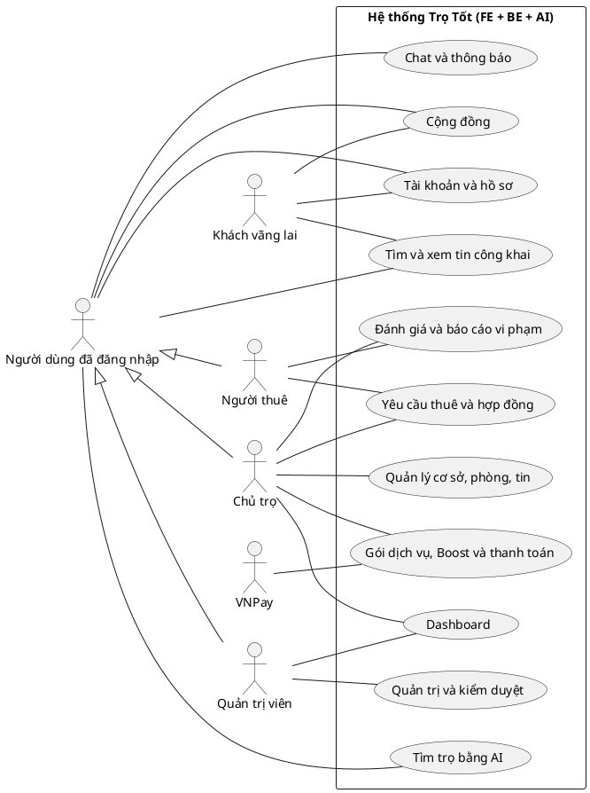

# Phân chia use case cho báo cáo đồ án Trọ Tốt

[README backend](README.md) · [API](docs/api.md) · [Nghiệp vụ](docs/BUSINESS.md)

## 0. Cách trình bày theo báo cáo tham khảo

Đã đối chiếu phần **2.1.3. Các Use case chính**, trang 29–42 theo mục lục trong [Báo cáo đồ án.docx](<Báo cáo đồ án.docx>). Phần này của file tham khảo còn là nghiệp vụ tuyển dụng, trong khi một số nội dung trước đó đã được thay sang quản lý cho thuê trọ. Chỉ áp dụng cách tổ chức báo cáo, không sao chép tác nhân, chức năng hay kiến trúc tuyển dụng vào dự án hiện tại.

### Mẫu tham khảo đã chia như thế nào?

Trước phần use case, mẫu có bảng **yêu cầu chức năng** gồm: mã yêu cầu, tên yêu cầu, mô tả chi tiết, tác nhân và độ ưu tiên; tiếp theo là bảng **yêu cầu phi chức năng**. Phần use case chọn các nghiệp vụ chính và trình bày theo 6 nhóm:

| Nhóm trong mẫu | Sơ đồ | Các bảng đặc tả đặt trong nhóm |
| --- | --- | --- |
| Quản lý yêu cầu tuyển dụng | Hình 2.1 | Khởi tạo yêu cầu; phê duyệt yêu cầu. |
| Quản lý vị trí tuyển dụng | Hình 2.2 | Thêm vị trí; xem ứng viên theo vị trí; thêm hồ sơ ứng viên; chuyển trạng thái hồ sơ. |
| Quản lý ứng viên | Hình 2.3 | Xem chi tiết; thêm nhận xét; gửi email; tạo lịch phỏng vấn. |
| Quản lý lịch | Hình 2.4 | Xem lịch tổng quan. |
| Quản lý luồng phê duyệt | Hình 2.5 | Thêm luồng phê duyệt. |
| Ứng viên nộp CV | Hình 2.6 | Nộp CV từ trang công khai. |

Như vậy mẫu có **6 sơ đồ theo nghiệp vụ và 13 bảng đặc tả** (Bảng 2.3–2.15). Đây là số bảng được chọn trình bày, không phải tổng số chức năng của hệ thống tuyển dụng. Mẫu không chia chương thành ba phần riêng theo từng vai trò và không đặc tả mọi thao tác CRUD. “Phân rã dịch vụ con” ở mục 2.1.4 là phần kiến trúc tiếp theo, không phải phân rã use case.

### Phương án áp dụng cho Trọ Tốt

Phần báo cáo nên dùng **8 nhóm nghiệp vụ, 8 sơ đồ và 18 bảng đặc tả chính** được chọn ở mục 4–5. Con số này là đề xuất cho phạm vi Trọ Tốt, không phải quy định của mẫu. Danh sách 64 mục ở dưới giữ vai trò danh mục chức năng/use case để đối chiếu và phân rã, không yêu cầu viết 64 bảng đặc tả.

Trình tự đề xuất cho chương 2:

1. **2.1.1. Yêu cầu chức năng:** lập bảng theo mẫu; dùng mã REQ-TK01, REQ-TC01… tương ứng chức năng trong danh mục, bổ sung mô tả/tác nhân/độ ưu tiên.
2. **2.1.2. Yêu cầu phi chức năng:** ghi yêu cầu của chính dự án về bảo mật, toàn vẹn giao dịch, hiệu năng, thông báo và khả năng bảo trì; không sao chép các cam kết microservice của mẫu.
3. **2.1.3. Các use case chính:** lần lượt trình bày 8 nhóm; mỗi nhóm đặt sơ đồ trước, các bảng đặc tả tiêu biểu sau.
4. **Phần kiến trúc tiếp theo:** mô tả đúng FE Angular, BE chia module và AIService của dự án, điều chỉnh tiêu đề theo đề cương được duyệt.

Mã TK01… trong tài liệu này là mã use case; mã REQ-TK01… được đề xuất riêng cho bảng yêu cầu. Một use case có thể liên quan nhiều yêu cầu. Ví dụ xác nhận hợp đồng vừa thực hiện yêu cầu đồng ý hợp đồng vừa cập nhật trạng thái phòng và gửi thông báo; không cần ép một yêu cầu luôn tương ứng một use case.

## 1. Phạm vi và cách phân chia

Tài liệu liệt kê **64 mục use case thuộc 12 nhóm chức năng để khảo sát đầy đủ**, dựa trên mã nguồn backend RentalManagement, các route/service frontend DOANTOTNGHIEPFE và API của AIService tại thời điểm khảo sát 18/11/2026. Khi đưa vào báo cáo theo mẫu, gom thành **8 nhóm nghiệp vụ và chọn 18 use case chính để đặc tả**, theo mục 4–5. Đây là phân tích từ mã nguồn; không phải kết quả kiểm thử chạy thực tế toàn hệ thống.

Mỗi use case thể hiện một mục tiêu của tác nhân. Các thao tác thêm/sửa/xóa, lọc/phân trang và tải ảnh được gom khi cùng phục vụ một mục tiêu quản lý. Có thể tách thành use case con khi viết đặc tả chi tiết, nhưng không cần vẽ mỗi API thành một hình ellipse.

Ranh giới hệ thống trong báo cáo bao gồm FE, BE và AIService. Vì vậy AIService là thành phần nội bộ; VNPay và dịch vụ email/lưu trữ/bản đồ là các hệ thống bên ngoài. Database, bộ lập lịch, hàng đợi và JWT là thành phần kỹ thuật, không phải tác nhân người dùng.

## 2. Các tác nhân

| Mã | Tác nhân | Vai trò |
| --- | --- | --- |
| A01 | Khách vãng lai | Chưa đăng nhập; tìm, xem tin công khai, đánh giá công khai, nội dung cộng đồng; đăng ký, đăng nhập, khôi phục mật khẩu. |
| A02 | Người thuê — TENANT | Gửi yêu cầu thuê, xác nhận hợp đồng, thiết lập nhu cầu tìm trọ, đánh giá và báo cáo vi phạm. |
| A03 | Chủ trọ — LANDLORD | Quản lý cơ sở/phòng/tin; xử lý yêu cầu thuê, bàn giao; mua gói, Boost và thanh toán. |
| A04 | Quản trị viên — ADMIN | Duyệt tin, quản lý tài khoản/danh mục/phân quyền, xử lý vi phạm, kiểm duyệt, theo dõi thanh toán và thống kê. |
| A05 | VNPay Sandbox | Tiếp nhận thanh toán, gửi IPN và trả kết quả truy vấn giao dịch. |
| A06 | Dịch vụ email | Gửi OTP xác thực email và khôi phục mật khẩu. |
| A07 | Dịch vụ lưu trữ Cloudinary | Lưu ảnh và PDF hợp đồng; tham gia các bước tải lên/tải xuống tài liệu. |
| A08 | Dịch vụ bản đồ MapTiler | Hỗ trợ hiển thị bản đồ và chọn vị trí trên giao diện. |

“Người dùng đã đăng nhập” trong các bảng là tác nhân khái quát của A02/A03/A04. Chỉ dùng kế thừa để gom chức năng chung như hồ sơ, chat, thông báo; không suy ra ADMIN được thực hiện mọi thao tác của TENANT/LANDLORD. Quyền còn phụ thuộc authority, trạng thái tài khoản, quyền sở hữu và quan hệ với dữ liệu.

## 3. Danh sách use case

### Nhóm 1 — Tài khoản và hồ sơ: 8 use case

| Mã | Use case | Tác nhân chính | Phạm vi/kết quả |
| --- | --- | --- | --- |
| TK01 | Đăng ký tài khoản | Khách | Tạo tài khoản theo vai trò đăng ký mà hệ thống cho phép. |
| TK02 | Xác thực email | Khách/người dùng | Yêu cầu OTP và xác thực email bằng OTP hợp lệ. |
| TK03 | Đăng nhập | Khách | Xác thực thông tin và thiết lập phiên sử dụng. |
| TK04 | Đăng xuất | Người dùng đã đăng nhập | Kết thúc phiên theo cơ chế xác thực hiện có. |
| TK05 | Khôi phục mật khẩu | Khách | Yêu cầu OTP và đặt lại mật khẩu khi quên. |
| TK06 | Đổi mật khẩu | Người dùng đã đăng nhập | Đổi mật khẩu từ hồ sơ cá nhân. |
| TK07 | Quản lý hồ sơ cá nhân | Người dùng đã đăng nhập | Xem/cập nhật thông tin, thay hoặc xóa ảnh đại diện. |
| TK08 | Thiết lập hồ sơ tìm trọ | Người thuê | Lưu ngân sách, diện tích, khu vực, loại phòng, tiện ích, địa điểm muốn ở gần và lựa chọn cá nhân hóa. |

### Nhóm 2 — Tra cứu và tìm phòng: 6 use case

| Mã | Use case | Tác nhân chính | Phạm vi/kết quả |
| --- | --- | --- | --- |
| TC01 | Tìm kiếm và lọc tin cho thuê | Khách/người dùng | Lọc theo các tiêu chí hệ thống hỗ trợ, sắp xếp và xem kết quả phân trang. |
| TC02 | Tìm phòng trên bản đồ | Khách/người dùng | Xem tin theo vị trí/phạm vi bản đồ và bộ lọc. |
| TC03 | Xem chi tiết tin và phòng có thể thuê | Khách/người dùng | Xem cơ sở, giá/phí, tiện ích, ảnh và tình trạng đặt của từng phòng. |
| TC04 | Xem đánh giá công khai | Khách/người dùng | Xem đánh giá phòng/chủ trọ và điểm tổng hợp trong phạm vi được công khai. |
| TC05 | Xem số điện thoại chủ trọ | Khách/người dùng | Yêu cầu hiển thị số liên hệ từ tin hợp lệ. |
| TC06 | Tra cứu thống kê giá | Người dùng đã đăng nhập | Xem thống kê giá theo khu vực qua API hiện có; không mặc định là chức năng công khai. |

Danh mục tỉnh/phường, loại phòng, loại cơ sở và tiện ích phục vụ bộ lọc được mô tả là bước hỗ trợ của TC01/TC02. Chức năng xem số điện thoại khác với chat: chat yêu cầu đăng nhập và kiểm tra thành viên hội thoại.

### Nhóm 3 — Hỗ trợ tìm trọ bằng AI: 4 use case

| Mã | Use case | Tác nhân chính | Phạm vi/kết quả |
| --- | --- | --- | --- |
| AI01 | Tìm phòng bằng hội thoại | Người dùng đã đăng nhập, trọng tâm người thuê | Nhập nhu cầu bằng ngôn ngữ tự nhiên, tiếp tục điều chỉnh tiêu chí qua nhiều lượt và nhận tin phù hợp. |
| AI02 | Nhận gợi ý phòng cá nhân hóa | Người dùng đã đăng nhập, trọng tâm người thuê | Nhận danh sách gợi ý dựa trên dữ liệu/hồ sơ và điều kiện cá nhân hóa; có xử lý khi chưa đủ dữ liệu. |
| AI03 | Phản hồi câu trả lời AI | Người dùng đã đăng nhập | Gửi đánh giá hữu ích/không hữu ích và lý do cho câu trả lời của mình. |
| AI04 | Xem và sử dụng kết quả tìm trọ từ AI | Người dùng đã đăng nhập | Mở tin hoặc liên hệ từ kết quả; hệ thống ghi nhận tương tác hợp lệ gắn với lượt gợi ý. |

Các API AI yêu cầu Bearer token. Không gán AI01/AI02 cho khách chưa đăng nhập. AI04 là thao tác người dùng với kết quả; lưu sự kiện impression/click/contact là xử lý nội bộ, không cần tách thành use case kỹ thuật riêng. API ghi sự kiện SAVE không đủ để khẳng định đã có chức năng quản lý danh sách tin cho thuê yêu thích.

### Nhóm 4 — Cơ sở và phòng cho thuê: 3 use case

| Mã | Use case | Tác nhân chính | Phạm vi/kết quả |
| --- | --- | --- | --- |
| TS01 | Quản lý cơ sở cho thuê | Chủ trọ | Tạo cơ sở cùng phòng ban đầu, xem danh sách/chi tiết tài sản của mình. |
| TS02 | Cập nhật vị trí cơ sở | Chủ trọ | Cập nhật địa chỉ và tọa độ theo API vị trí cơ sở. |
| TS03 | Quản lý phòng thuộc cơ sở | Chủ trọ | Thêm/xem/sửa/xóa phòng theo điều kiện nghiệp vụ, cập nhật giá/phí, trạng thái và ảnh. |

Property là cơ sở vật lý, Room là đơn vị thuê, Listing là tin quảng bá. Thuê nguyên căn dùng một Room đại diện; không đồng nhất ba khái niệm này. Chưa có cơ sở để mô tả đầy đủ CRUD cơ sở vì PropertyController hiện tập trung tạo, xem và cập nhật vị trí.

### Nhóm 5 — Tin đăng và hiển thị: 5 use case

| Mã | Use case | Tác nhân chính | Phạm vi/kết quả |
| --- | --- | --- | --- |
| TD01 | Tạo tin cho thuê và gửi duyệt | Chủ trọ | Chọn cơ sở hợp lệ, nhập nội dung, chọn ưu tiên/Boost nếu có và gửi chờ duyệt. |
| TD02 | Theo dõi và cập nhật tin của mình | Chủ trọ | Xem trạng thái, sửa nội dung trong các trạng thái được phép. |
| TD03 | Ẩn tin cho thuê | Chủ trọ | Ngừng hiển thị tin, dừng ưu tiên/Boost đang gán theo quy tắc. |
| TD04 | Gửi duyệt lại tin | Chủ trọ | Gửi lại tin đủ điều kiện, kiểm tra hạn mức và bắt đầu thời gian chờ mới. |
| TD05 | Điều chỉnh ưu tiên hiển thị | Chủ trọ | Chọn/bỏ mức ưu tiên từ quyền lợi gói; việc phân bổ Boost riêng được nêu tại GD04. |

Duyệt/từ chối thuộc QT01. Tin không tự công khai sau khi tạo; quyền đăng, hạn mức, phòng còn có thể cho thuê và tin đang hiệu lực cùng cơ sở đều được kiểm tra.

### Nhóm 6 — Yêu cầu thuê và hợp đồng: 8 use case

| Mã | Use case | Tác nhân chính | Phạm vi/kết quả |
| --- | --- | --- | --- |
| TH01 | Gửi yêu cầu thuê phòng | Người thuê | Chọn đúng phòng từ tin hợp lệ, nhập thông tin và gửi yêu cầu. |
| TH02 | Theo dõi yêu cầu thuê của mình | Người thuê | Xem danh sách, chi tiết, trạng thái và tổng hợp yêu cầu. |
| TH03 | Hủy yêu cầu thuê | Người thuê | Hủy yêu cầu của mình khi trạng thái cho phép. |
| TH04 | Tiếp nhận và xử lý yêu cầu thuê | Chủ trọ | Lọc/xem yêu cầu, chấp nhận hoặc từ chối; chấp nhận khởi tạo hợp đồng và giữ phòng. |
| TH05 | Xem và tải hợp đồng PDF | Người thuê/chủ trọ liên quan; quản trị viên | Đọc chi tiết, theo dõi trạng thái tạo PDF và tải tài liệu theo quyền. |
| TH06 | Xác nhận đồng ý hợp đồng | Người thuê liên quan | Đồng ý đúng phiên bản PDF; hợp đồng có hiệu lực và phòng chuyển sang đã thuê. |
| TH07 | Từ chối hợp đồng chờ xác nhận | Người thuê liên quan | Từ chối hợp đồng, đóng trạng thái giữ phòng theo quy tắc. |
| TH08 | Xác nhận bàn giao và kết thúc thuê | Chủ trọ liên quan | Ghi nhận trả phòng/kết thúc hợp đồng đang hiệu lực theo API checkout. |

TH05 bao gồm quyền xem danh sách hợp đồng tương ứng của người thuê/chủ trọ. Quản trị viên có API đọc chi tiết/PDF, không có nghĩa được xác nhận thay người thuê hoặc có một màn hình quản lý toàn bộ hợp đồng.

### Nhóm 7 — Gói dịch vụ, Boost và thanh toán: 6 use case

| Mã | Use case | Tác nhân chính | Phạm vi/kết quả |
| --- | --- | --- | --- |
| GD01 | Xem gói dịch vụ và quyền lợi hiện tại | Chủ trọ | Xem danh mục/giá, kỳ quyền lợi, hạn mức và lịch sử gói. |
| GD02 | Đăng ký, gia hạn hoặc đổi gói dịch vụ | Chủ trọ | Tạo đơn mua/gia hạn/nâng/hạ gói theo điều kiện hệ thống. |
| GD03 | Mua gói Boost | Chủ trọ | Chọn gói suất Boost, tạo đăng ký chờ thanh toán, xem gói đã mua. |
| GD04 | Phân bổ Boost cho tin | Chủ trọ | Gán, thay đổi hoặc bỏ Boost bằng số suất thuộc gói hợp lệ. |
| GD05 | Thanh toán qua VNPay | Chủ trọ; VNPay là tác nhân hỗ trợ | Tạo checkout, thanh toán đơn gói/Boost; hệ thống xác minh kết quả và áp dụng quyền lợi nếu đủ điều kiện. |
| GD06 | Tra cứu giao dịch và hóa đơn | Chủ trọ | Xem lịch sử/chi tiết/hóa đơn của mình; chủ động kiểm tra lại giao dịch qua VNPay khi cần. |

Đối soát quản trị thuộc QT07. Nâng gói hợp lệ được áp dụng ngay; hạ/đổi ngang được xếp kỳ sau theo mã hiện tại. API admin xác nhận đổi gói còn phục vụ đơn cũ chờ xác nhận, không phải bước bắt buộc của mọi đơn mới.

### Nhóm 8 — Đánh giá sau thuê: 4 use case

| Mã | Use case | Tác nhân chính | Phạm vi/kết quả |
| --- | --- | --- | --- |
| DG01 | Đánh giá phòng đã thuê | Người thuê | Chấm điểm/nhận xét phòng theo hợp đồng đủ điều kiện. |
| DG02 | Đánh giá chủ trọ | Người thuê | Gửi đánh giá chủ trọ theo hợp đồng đủ điều kiện. |
| DG03 | Đánh giá và tra cứu đánh giá người thuê | Chủ trọ; người thuê/quản trị viên được đọc theo quyền | Chủ trọ tạo đánh giá từ hợp đồng; tra cứu đánh giá người thuê theo phạm vi BE cho phép. |
| DG04 | Theo dõi và phản hồi đánh giá | Người thuê/chủ trọ | Xem đánh giá đã gửi; chủ trọ xem đánh giá nhận được và phản hồi đánh giá phòng/chủ trọ. |

Mỗi hợp đồng chỉ có một đánh giá cho mỗi loại. Chưa có API tác giả sửa/xóa đánh giá. Không mô tả phản hồi cho đánh giá người thuê. Ẩn/khôi phục đánh giá là QT05.

### Nhóm 9 — Phản ánh vi phạm tin/chủ trọ: 3 use case

| Mã | Use case | Tác nhân chính | Phạm vi/kết quả |
| --- | --- | --- | --- |
| BC01 | Báo cáo tin đăng vi phạm | Người thuê | Chọn lý do, mô tả và tạo báo cáo tin còn công khai hợp lệ. |
| BC02 | Báo cáo chủ trọ vi phạm | Người thuê | Tạo báo cáo chủ trọ khi đáp ứng điều kiện quan hệ thuê; giữ ngữ cảnh hợp đồng/tin liên quan. |
| BC03 | Bổ sung minh chứng và theo dõi báo cáo | Người thuê | Tải ảnh khi báo cáo còn chờ, xem hồ sơ và kết quả xử lý của mình. |

Nhóm này khác báo cáo bài viết/bình luận cộng đồng. Chủ trọ không mặc định được đọc hồ sơ minh chứng riêng tư của người thuê.

### Nhóm 10 — Cộng đồng: 6 use case

| Mã | Use case | Tác nhân chính | Phạm vi/kết quả |
| --- | --- | --- | --- |
| CD01 | Xem và tìm bài viết cộng đồng | Khách/người dùng | Xem bảng tin, chi tiết bài, bình luận và trang tác giả trong phạm vi hiển thị. |
| CD02 | Quản lý bài viết của mình | Người dùng đã đăng nhập | Tạo/sửa/xóa bài, đính kèm ảnh và liên kết tin theo chức năng hiện có. |
| CD03 | Bình luận và trả lời bình luận | Người dùng đã đăng nhập | Thêm/sửa/xóa bình luận thuộc quyền của mình. |
| CD04 | Tương tác và lưu bài viết | Người dùng đã đăng nhập | Bày tỏ/gỡ cảm xúc, lưu/bỏ lưu bài, theo dõi/bỏ theo dõi tác giả. |
| CD05 | Báo cáo nội dung cộng đồng | Người dùng đã đăng nhập | Báo cáo bài viết/bình luận vi phạm để kiểm duyệt. |
| CD06 | Yêu cầu xem xét lại bài viết | Tác giả đã đăng nhập | Gửi yêu cầu xét lại bài của mình theo điều kiện kiểm duyệt. |

Ghim/bỏ ghim bài là thao tác quản trị trong QT06. Lưu bài cộng đồng khác với lưu tin cho thuê.

### Nhóm 11 — Quản trị hệ thống: 8 use case

| Mã | Use case | Tác nhân chính | Phạm vi/kết quả |
| --- | --- | --- | --- |
| QT01 | Kiểm duyệt tin cho thuê | Quản trị viên | Xem tin, duyệt hoặc từ chối tin chờ; nhập lý do và áp dụng quy tắc hạn mức. |
| QT02 | Quản lý người dùng | Quản trị viên theo quyền | Tra cứu/tạo/cập nhật/xóa theo điều kiện, quản lý trạng thái tài khoản. |
| QT03 | Quản lý vai trò và quyền | Quản trị viên theo quyền | Xem ma trận, bật/tắt quyền theo khả năng quản trị hiện có. |
| QT04 | Quản lý danh mục hệ thống | Quản trị viên theo quyền | Quản lý tiện ích, loại phòng, loại cơ sở, phường/xã, gói dịch vụ, bảng giá và gói Boost. |
| QT05 | Kiểm duyệt đánh giá | Quản trị viên có quyền tương ứng | Tra cứu, ẩn/khôi phục đánh giá và lưu lý do. |
| QT06 | Kiểm duyệt cộng đồng | Quản trị viên | Quản lý/thử quy tắc, xem hồ sơ kiểm duyệt, ra quyết định và ghim/bỏ ghim bài. |
| QT07 | Theo dõi và kiểm tra thanh toán toàn hệ thống | Quản trị viên | Xem giao dịch/hóa đơn, danh sách cần đối soát, truy vấn lại VNPay; xử lý xác nhận đơn đổi gói cũ nếu có. |
| QT08 | Tiếp nhận và giải quyết báo cáo vi phạm | Quản trị viên có quyền đọc/xử lý | Nhận hồ sơ, kiểm tra minh chứng, phê duyệt/từ chối, ghi kết quả; hệ thống áp dụng chế tài tương ứng. |

QT04 là use case tổng hợp. Khi vẽ phân rã, tách thành “Quản lý tiện ích”, “Quản lý loại phòng”, “Quản lý loại cơ sở”, “Quản lý phường/xã”, “Quản lý gói dịch vụ và bảng giá”, “Quản lý gói Boost”. Đây là các use case con, không cộng lại vào con số 64 ở cấp hiện tại.

### Nhóm 12 — Chat, thông báo và thống kê: 3 use case

| Mã | Use case | Tác nhân chính | Phạm vi/kết quả |
| --- | --- | --- | --- |
| HT01 | Trao đổi tin nhắn và liên hệ hỗ trợ | Người thuê/chủ trọ/quản trị viên tham gia hội thoại | Mở chat từ tin hoặc chat hỗ trợ, gửi/đọc tin, xem lịch sử và trạng thái đọc. |
| HT02 | Xem và quản lý thông báo | Người dùng đã đăng nhập | Xem hộp thư, số chưa đọc, đánh dấu đọc từng thông báo hoặc tất cả. |
| HT03 | Xem bảng tổng quan và thống kê | Chủ trọ/quản trị viên | Xem dashboard tương ứng; số liệu chi tiết của chủ trọ chịu điều kiện quyền lợi gói. |

HT01 có thể phân rã thành “Chat người thuê – chủ trọ” và “Chat hỗ trợ”. Quản trị viên chỉ đọc hội thoại mình tham gia, không mặc định xem toàn bộ tin nhắn riêng.

## 4. Cách tổ chức sơ đồ trong báo cáo

Theo cách trình bày của mẫu, dùng 8 tiểu mục nghiệp vụ dưới đây. Mỗi tiểu mục gồm một sơ đồ use case nhóm, sau đó là các bảng đặc tả được chọn ở mục 5. Sơ đồ có thể chứa cả chức năng phụ không được chọn viết bảng. Sơ đồ tổng quan toàn hệ thống là phần bổ sung tùy chọn.

| Sơ đồ | Tác nhân | Use case đưa vào |
| --- | --- | --- |
| 1. Quản lý tài khoản và hồ sơ | Khách, người thuê, chủ trọ, quản trị viên, email | TK01–TK08, QT02–QT03 |
| 2. Tìm kiếm và gợi ý phòng trọ | Khách, người dùng đăng nhập, bản đồ | TC01–TC06, AI01–AI04; TK08 là thiết lập liên quan |
| 3. Quản lý cơ sở, phòng và tin đăng | Chủ trọ, quản trị viên, lưu trữ | TS01–TS03, TD01–TD05, QT01 |
| 4. Quản lý yêu cầu thuê và hợp đồng | Người thuê, chủ trọ, quản trị viên được đọc, lưu trữ | TH01–TH08 |
| 5. Quản lý gói dịch vụ, Boost và thanh toán | Chủ trọ, quản trị viên, VNPay | GD01–GD06, QT07 |
| 6. Quản lý đánh giá và báo cáo vi phạm | Người thuê, chủ trọ, quản trị viên | DG01–DG04, BC01–BC03, QT05, QT08 |
| 7. Quản lý cộng đồng và kiểm duyệt nội dung | Khách, người dùng đăng nhập, quản trị viên | CD01–CD06, QT06 |
| 8. Trao đổi, thông báo và quản trị bổ trợ | Người thuê, chủ trọ, quản trị viên | HT01–HT03, QT04 |

Nhóm 8 gom các chức năng hỗ trợ để trình bày gọn. Trong hình, đặt chat, thông báo, dashboard và danh mục thành các cụm rõ ràng; không vẽ một ellipse “quản trị bổ trợ” bao trùm mọi thao tác. Không gán mọi chức năng trong một nhóm cho mọi tác nhân được liệt kê; nối theo quyền cụ thể trong danh mục mục 3.

Sơ đồ tổng quan tham khảo bằng PlantUML (đây là các nhóm mục tiêu, không thay thế danh sách use case chi tiết):

### Quan hệ include/extend nên thể hiện

- **Chấp nhận yêu cầu thuê** (nhánh TH04) `<<include>>` **Khởi tạo hợp đồng và giữ phòng**: luôn xảy ra khi chấp nhận thành công. Tạo PDF là xử lý tự động tiếp theo, không gán tác nhân chủ trọ phải tự tải PDF lên.
- **Xác nhận đồng ý hợp đồng** (TH06) `<<include>>` **Kiểm tra phiên bản/toàn vẹn PDF**: điều kiện bắt buộc trước khi ghi nhận đồng ý đúng tài liệu.
- **Phân bổ Boost khi tạo tin** `<<extend>>` **Tạo tin cho thuê** (TD01), tại điểm mở rộng lựa chọn ưu tiên, nếu chủ trọ chọn gói Boost hợp lệ. GD04 cũng có thể được thực hiện sau khi đã có tin.
- **Bổ sung ảnh minh chứng** (một phần BC03) `<<extend>>` **Báo cáo vi phạm** (BC01/BC02), khi người thuê chọn bổ sung và hồ sơ còn PENDING.
- **Áp dụng chế tài** `<<extend>>` **Giải quyết báo cáo** (QT08), trong nhánh xác nhận vi phạm; loại chế tài phụ thuộc số lần đã xác nhận.

Mũi tên include đi từ use case chính tới hành vi bắt buộc; mũi tên extend đi từ hành vi tùy chọn/có điều kiện tới use case được mở rộng. Quan hệ này mô tả sự phụ thuộc hành vi, không biểu diễn thứ tự màn hình. Đăng nhập thường là tiền điều kiện của các chức năng bảo vệ; không nối include đăng nhập vào mọi use case. Không nối “gửi yêu cầu thuê include chủ trọ duyệt” vì đây là hai mục tiêu độc lập, thực hiện bởi hai tác nhân ở các thời điểm khác nhau.

## 5. Những use case nên đặc tả kỹ trong báo cáo

Chọn 18 bảng sau để thể hiện cả nghiệp vụ cốt lõi và chức năng AI của đồ án. Đây là các bảng đặt ngay sau sơ đồ của từng nhóm, tương tự mẫu năm ngoái.

| Nhóm báo cáo | Use case chọn đặc tả | Số bảng |
| --- | --- | --- |
| 1. Tài khoản và hồ sơ | TK01 Đăng ký; TK08 Thiết lập hồ sơ tìm trọ | 2 |
| 2. Tìm kiếm và gợi ý | TC01 Tìm kiếm/lọc; AI01 Tìm phòng bằng hội thoại; AI02 Nhận gợi ý cá nhân hóa | 3 |
| 3. Cơ sở, phòng và tin đăng | TS01 Tạo cơ sở cùng phòng ban đầu (nhánh chính của quản lý cơ sở); TD01 Tạo tin; QT01 Duyệt tin | 3 |
| 4. Yêu cầu thuê và hợp đồng | TH01 Gửi yêu cầu; TH04 Chấp nhận yêu cầu (từ chối là luồng thay thế); TH06 Xác nhận hợp đồng; TH08 Xác nhận bàn giao | 4 |
| 5. Gói và thanh toán | GD02 Đăng ký/gia hạn/đổi gói; GD05 Thanh toán VNPay | 2 |
| 6. Đánh giá và báo cáo | DG01 Đánh giá phòng; QT08 Giải quyết báo cáo vi phạm | 2 |
| 7. Cộng đồng | CD02 Tạo bài viết (nhánh chính); QT06 Xử lý hồ sơ kiểm duyệt (nhánh chính) | 2 |
| 8. Chức năng bổ trợ | Thể hiện trên sơ đồ và bảng yêu cầu; chưa chọn bảng đặc tả riêng | 0 |
| **Tổng** | | **18** |

Đăng nhập, đổi mật khẩu, chat, thông báo và CRUD danh mục vẫn được liệt kê trong yêu cầu/sơ đồ. Việc không chọn bảng đặc tả riêng không loại bỏ chức năng khỏi phạm vi dự án. Nếu cần thêm, ưu tiên HT01 Chat và GD04 Phân bổ Boost.

### Mẫu bảng đặc tả bám báo cáo tham khảo

Tên use case đặt ngay trước bảng. Các trường theo đúng cấu trúc mẫu: **Mục tiêu, Mã yêu cầu, Tác nhân, Điều kiện đầu vào, Điều kiện đầu ra, Kịch bản, Ngoại lệ, Luồng thay thế**. Có thể thêm mã use case để dễ truy vết. Kịch bản đánh số các bước thao tác của người dùng xen kẽ phản hồi của hệ thống; ngoại lệ/luồng thay thế dẫn lại bước tương ứng.

Ví dụ: **TH01 — Gửi yêu cầu thuê phòng**.

| Thành phần | Nội dung |
| --- | --- |
| Mục tiêu | Cho phép người thuê gửi yêu cầu thuê một phòng từ tin đang công khai hợp lệ. |
| Mã yêu cầu | REQ-TH01; tham chiếu thêm REQ-TC03 về xem thông tin phòng. Các mã này dùng cho bảng yêu cầu chức năng đề xuất. |
| Tác nhân | Người thuê. |
| Điều kiện đầu vào | Người thuê đã đăng nhập; tài khoản hợp lệ; tin PUBLISHED còn hạn; phòng thuộc cơ sở của tin và có thể đặt theo kiểm tra BE. |
| Điều kiện đầu ra | Tạo yêu cầu PENDING, lưu dữ liệu và hiển thị trạng thái cho người thuê; chưa phát sinh hợp đồng hiệu lực hoặc thu tiền thuê/cọc. |
| Kịch bản | 1. Người thuê mở tin và chọn phòng muốn thuê. 2. Hệ thống hiển thị trang gửi yêu cầu cùng thông tin giá/phí. 3. Người thuê điền thông tin bắt buộc và thời hạn thuê. 4. Người thuê gửi yêu cầu. 5. Hệ thống kiểm tra dữ liệu, hiệu lực tin, quyền và tình trạng phòng. 6. Hệ thống lưu yêu cầu PENDING và trả kết quả. 7. Người thuê xem yêu cầu đã tạo. |
| Ngoại lệ | 5a. Dữ liệu không hợp lệ: báo lỗi, không tạo yêu cầu. 5b. Tin hết hiệu lực hoặc phòng không thể đặt: từ chối thao tác, yêu cầu xem lại thông tin. 5c. Đã có yêu cầu PENDING cùng phòng với nội dung khác: báo xung đột, không tạo thêm. |
| Luồng thay thế | 5d. Gửi lại đúng toàn bộ nội dung của yêu cầu PENDING đã có: trả yêu cầu cũ, không tạo trùng. |

Không tự đặt nội dung hộp thoại, nút bấm, thông báo hoặc cam kết gửi email nếu giao diện/mã nguồn chưa xác nhận. Các bản tóm tắt luồng dưới đây là căn cứ để viết bảng đầy đủ theo mẫu trên.

### TH01 — Gửi yêu cầu thuê phòng

- **Tác nhân/kích hoạt:** người thuê nhấn đặt phòng từ một tin cho thuê.
- **Tiền điều kiện:** tài khoản hợp lệ; tin PUBLISHED còn hạn; phòng thuộc cơ sở của tin và có thể đặt theo `bookingAvailability` do BE xác định.
- **Luồng chính:** chọn phòng → xem giá/phí → nhập thông tin và thời hạn → gửi → hệ thống kiểm tra → tạo yêu cầu PENDING → hiển thị mã/trạng thái yêu cầu.
- **Ngoại lệ:** phòng đã bị giữ/thuê/bảo trì, tin hết hiệu lực, dữ liệu không hợp lệ; một người thuê không có hai yêu cầu PENDING cho cùng phòng. Gửi lại cùng payload được trả yêu cầu cũ; payload khác khi đã có yêu cầu chờ bị từ chối.
- **Hậu điều kiện:** có yêu cầu chờ; chưa phát sinh hợp đồng hiệu lực, chưa thu tiền thuê/cọc và chưa giữ độc quyền phòng. Yêu cầu chờ có hạn 7 ngày.

### TH04 — Chủ trọ xử lý yêu cầu thuê

- **Tác nhân/kích hoạt:** chủ trọ mở một yêu cầu thuộc phòng của mình.
- **Tiền điều kiện:** yêu cầu còn được xử lý; kiểm tra lại khả năng cho thuê khi chấp nhận.
- **Luồng chính chấp nhận:** đọc yêu cầu → chấp nhận → hệ thống khóa/kiểm tra phòng → chuyển yêu cầu ACCEPTED → tạo hợp đồng PENDING_CONFIRMATION và snapshot điều khoản → giữ phòng 48 giờ → xếp việc tạo PDF và gửi thông báo.
- **Luồng thay thế:** từ chối kèm lý do; khi chấp nhận thành công, các yêu cầu PENDING khác cùng phòng được tự từ chối. Chấp nhận lại cùng yêu cầu trả về hợp đồng đã tạo.
- **Ngoại lệ:** phòng vừa có giao dịch khác, yêu cầu quá hạn hoặc người gọi không sở hữu tài sản.
- **Hậu điều kiện:** nhánh chấp nhận có một hợp đồng chờ người thuê đồng ý; phòng chưa chuyển thành RENTED chỉ vì chủ trọ chấp nhận.

### TH06 — Người thuê xác nhận hợp đồng

- **Tác nhân/kích hoạt:** đúng người thuê của hợp đồng chọn đồng ý.
- **Tiền điều kiện:** hợp đồng chờ xác nhận, còn trong hạn giữ; PDF đã READY, được tải và kiểm tra tính toàn vẹn/phiên bản.
- **Luồng chính:** xem hợp đồng PDF → đồng ý điều khoản → gửi thông tin xác nhận đúng tài liệu → hệ thống kiểm tra trạng thái/phiên bản → chuyển hợp đồng ACTIVE và phòng RENTED trong cùng giao dịch → gửi thông báo.
- **Luồng thay thế:** người thuê chọn từ chối qua TH07; hợp đồng chờ quá 48 giờ được hủy theo luồng tự động.
- **Ngoại lệ:** PDF chưa sẵn sàng/lỗi, tài liệu không khớp, đã hết hạn hoặc không đúng người thuê; không ghi nhận đồng ý thành công.
- **Hậu điều kiện:** hợp đồng có hiệu lực và phòng đã thuê. Đây là đồng ý điện tử trong ứng dụng, không mô tả thành chữ ký số có chứng thư.

### TD01 — Tạo tin cho thuê

- **Tiền điều kiện:** chủ trọ có cơ sở của mình, có phòng AVAILABLE, có quyền/lượt đăng hợp lệ; không có tin PENDING/PUBLISHED còn hiệu lực khác cho cùng cơ sở.
- **Luồng chính:** chọn cơ sở → nhập tiêu đề/nội dung → chọn mức ưu tiên hoặc Boost nếu cần → gửi → kiểm tra và trừ lượt trong cùng giao dịch → tạo tin PENDING.
- **Ngoại lệ:** hết lượt, gói hết hạn, Boost sai chủ/hết lượt, cơ sở không hợp lệ; toàn bộ thao tác thất bại được hoàn tác.
- **Hậu điều kiện:** tin chờ duyệt tối đa 7 ngày. Admin duyệt mới bắt đầu thời gian hiển thị một tháng lịch. Không mô tả tạo tin là tự xuất bản.

### GD05 — Thanh toán gói/Boost qua VNPay

- **Tác nhân:** chủ trọ; VNPay hỗ trợ xác nhận thanh toán.
- **Tiền điều kiện:** đơn thuộc chủ trọ, còn hạn và có thể thanh toán; giá lấy từ snapshot của đơn.
- **Luồng chính:** yêu cầu checkout → nhận URL → thanh toán tại VNPay → BE nhận IPN hợp lệ hoặc kết quả QueryDr hợp lệ → ghi SUCCESS và hóa đơn → áp dụng quyền lợi nếu đủ điều kiện → người dùng xem kết quả qua API.
- **Luồng thay thế:** đang chờ xác nhận thì kiểm tra lại; giao dịch thất bại/hết hạn không tự cấp quyền. Khoản đã thu nhưng trùng/quá hạn/không đủ điều kiện được đánh dấu cần đối soát, không cấp quyền lần nữa.
- **Quy tắc:** Return trên trình duyệt không tự ghi nhận thành công. Callback lặp không tạo thêm hóa đơn/kỳ quyền lợi. Không có bước client tự đánh dấu đã trả tiền. Trường hợp nâng gói chênh lệch bằng 0 được áp dụng ngay khi tạo đơn, bỏ qua GD05.
- **Hậu điều kiện:** trạng thái giao dịch được lưu đúng kết quả đã xác minh; quyền lợi chỉ thay đổi nếu đủ điều kiện.

### QT08 — Giải quyết báo cáo vi phạm

- **Tác nhân:** quản trị viên có REPORT_READ/REPORT_HANDLE theo thao tác.
- **Tiền điều kiện:** hồ sơ tồn tại; người kết thúc là người đã nhận xử lý.
- **Luồng chính:** xem hồ sơ PENDING → nhận xử lý thành PROCESSING → kiểm tra mô tả, minh chứng và tin liên quan → nhập kết quả → xác nhận vi phạm thành RESOLVED → hệ thống tính mức chế tài và gửi thông báo.
- **Luồng thay thế:** không đủ cơ sở thì kết thúc REJECTED kèm ghi chú; không tăng số vi phạm đã xác nhận.
- **Chế tài:** lần 1 cảnh báo; lần 2 ẩn tin liên quan và ngăn ưu tiên trên các tin hiện có theo quy tắc; từ lần 3 khóa tài khoản chủ trọ. Khi báo cáo trực tiếp chủ trọ thiếu ngữ cảnh tin ở mức 2, phải chọn tin phù hợp trước khi phê duyệt.
- **Hậu điều kiện:** kết quả, bộ đếm vi phạm, chế tài và hàng đợi thông báo được ghi nhất quán; lịch sử hợp đồng/thanh toán được bảo toàn.

## 6. Các ranh giới cần ghi đúng

- Hệ thống thu tiền **gói dịch vụ và Boost qua VNPay Sandbox**, chưa có thanh toán tiền thuê/cọc, hoàn tiền tự động, MoMo hoặc chuyển khoản trong luồng hiện có.
- Không mô tả quản lý hóa đơn điện/nước hàng tháng, nhắc thu tiền thuê, đặt lịch xem phòng, ký số chứng thực, xác minh CCCD/KYC hoặc đặt trước nhiều khoảng thời gian là chức năng đã triển khai.
- Không tự kết thúc thuê và giải phóng phòng khi đến ngày kết thúc hợp đồng; luồng đang hiệu lực kết thúc qua xác nhận bàn giao của chủ trọ.
- Ẩn/hết hạn tin hoặc bỏ Boost không mặc định hoàn lượt đã dùng. Chỉ trường hợp từ chối lần duyệt đầu đáp ứng điều kiện mới hoàn lượt tương ứng.
- Báo cáo vi phạm tin/chủ trọ, báo cáo cộng đồng và phản hồi AI là ba nghiệp vụ riêng, có điều kiện và luồng xử lý khác nhau.
- Danh sách trên không khẳng định mọi API đều có màn hình riêng; tiêu biểu là tra cứu thống kê giá, một số thao tác quản trị và đọc hợp đồng của admin.
- Khi tài liệu mô tả cũ khác mã xử lý hiện tại, cần đối chiếu service. Ví dụ mô tả tổng quát trong BUSINESS.md còn nói đổi gói cần admin, trong khi ServiceSubscriptionServiceImpl và mục 10.3 của api.md đã áp dụng luồng nâng ngay/xếp kỳ tự động.

## 7. Căn cứ đối chiếu mã nguồn

| Phần nghiệp vụ | Nguồn chính |
| --- | --- |
| Xác thực và quyền công khai | [AuthController](src/main/java/com/tamdaptit/rentalmanagement/auth/controller/AuthController.java), [SecurityConfig](src/main/java/com/tamdaptit/rentalmanagement/common/config/SecurityConfig.java) |
| Người dùng, hồ sơ nhu cầu và phân quyền | [Identity controllers](src/main/java/com/tamdaptit/rentalmanagement/identity/controller), [Hồ sơ tìm trọ](docs/tenant-preferences.md) |
| Cơ sở, phòng và tin | [PropertyController](src/main/java/com/tamdaptit/rentalmanagement/property/controller/PropertyController.java), [RoomController](src/main/java/com/tamdaptit/rentalmanagement/room/controller/RoomController.java), [ListingController](src/main/java/com/tamdaptit/rentalmanagement/listing/controller/ListingController.java) |
| Yêu cầu thuê và hợp đồng | [Rental controllers](src/main/java/com/tamdaptit/rentalmanagement/rental/controller), [Nghiệp vụ thuê/PDF](docs/BUSINESS.md) |
| Gói dịch vụ và Boost | [Subscription controllers](src/main/java/com/tamdaptit/rentalmanagement/subscription/controller), [ServiceSubscriptionServiceImpl](src/main/java/com/tamdaptit/rentalmanagement/subscription/service/impl/ServiceSubscriptionServiceImpl.java) |
| Thanh toán | [PaymentController](src/main/java/com/tamdaptit/rentalmanagement/payment/controller/PaymentController.java), [API mục 11](docs/api.md) |
| Đánh giá và báo cáo | [ReviewController](src/main/java/com/tamdaptit/rentalmanagement/review/controller/ReviewController.java), [ReportController](src/main/java/com/tamdaptit/rentalmanagement/report/controller/ReportController.java), [Chế tài](docs/REPORT_SANCTIONS.md) |
| Cộng đồng và kiểm duyệt | [CommunityController](src/main/java/com/tamdaptit/rentalmanagement/community/controller/CommunityController.java), [ContentModerationController](src/main/java/com/tamdaptit/rentalmanagement/moderation/controller/ContentModerationController.java) |
| Chat, thông báo, dashboard | Các controller trong [chat](src/main/java/com/tamdaptit/rentalmanagement/chat/controller), [notification](src/main/java/com/tamdaptit/rentalmanagement/notification/controller), [dashboard](src/main/java/com/tamdaptit/rentalmanagement/dashboard/controller); [Chat hỗ trợ](docs/CHAT_SUPPORT.md) |
| AI | [Chat API](../AIService/app/api/chat.py), [Recommendations API](../AIService/app/api/recommendations.py), [Feedback/events](../AIService/app/api/events.py), [Xác thực AI](../AIService/app/core/deps.py) |
| Màn hình FE | Các route [tenant](../DOANTOTNGHIEPFE/src/app/features/tenant/tenant.routes.ts), [landlord](../DOANTOTNGHIEPFE/src/app/features/landlord/landlord.routes.ts), [admin](../DOANTOTNGHIEPFE/src/app/features/admin/admin.routes.ts) và [AI service FE](../DOANTOTNGHIEPFE/src/app/core/services/ai/ai.service.ts) |
