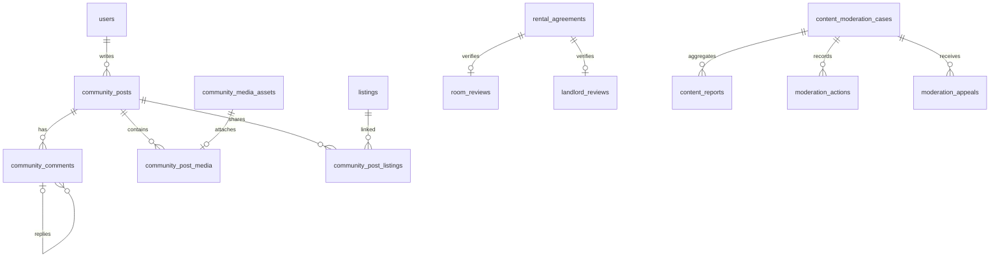

# Thiết kế mạng xã hội cộng đồng và kiểm duyệt nội dung dùng chung

Ngày: 12/11/2026. Phiên bản thiết kế: 1.0.

Tài liệu đầu vào: [community_feed_edit.txt](../community_feed_edit.txt). Tài liệu này cụ thể hóa gợi ý thành yêu cầu nghiệp vụ, mô hình dữ liệu, API, giao diện và tiêu chí nghiệm thu. Đây là bản thiết kế để triển khai; chưa phải các tính năng đã có trong ứng dụng.

**Yêu cầu đã chốt: đánh giá trên listing không được đăng tự do. Chỉ người đang thuê hoặc đã từng thuê, được xác thực bằng hợp đồng của hệ thống, mới được đánh giá. Không bổ sung khu vực bình luận tự do vào listing.** Bộ kiểm duyệt dùng chung cho bài đăng, bình luận mạng xã hội, phần chữ của đánh giá listing và phản hồi của chủ trọ.

## 1. Mục tiêu và phạm vi

### 1.1. Mục tiêu

- Tạo cộng đồng hỏi đáp, tìm người ở ghép, chia sẻ kinh nghiệm thuê và giới thiệu tin phòng.
- Người thuê, chủ trọ, admin dùng chung một loại bài đăng; không thêm `post_type` hay phân loại bài bắt buộc.
- Cho phép đính kèm tin phòng công khai, cảm xúc, bình luận hai cấp, lưu bài và theo dõi.
- Chủ trọ đủ điều kiện được ưu tiên theo gói/boost; không ưu tiên nội dung vi phạm.
- Admin quản lý được các từ/cụm từ, tên miền và mức xử lý mà không phải sửa mã nguồn.
- Có hàng đợi kiểm duyệt, lịch sử xử lý, lý do cho tác giả và cơ chế yêu cầu xem xét lại.

### 1.2. Phân biệt ba nghiệp vụ

| Nghiệp vụ | Ai được viết? | Điều kiện | Dữ liệu |
| --- | --- | --- | --- |
| Bài đăng cộng đồng | Tài khoản ACTIVE có vai trò được phép | Đăng nhập, qua giới hạn và bộ lọc | Bảng bài cộng đồng mới |
| Bình luận dưới bài cộng đồng | Tài khoản ACTIVE có vai trò được phép | Bài đang cho tương tác; không cần từng thuê | Bảng bình luận cộng đồng mới |
| Đánh giá phòng/chủ trọ trên listing | Người thuê thuộc hợp đồng tương ứng | Đang/đã thuê thực tế, hợp đồng đủ điều kiện; mỗi loại một lần/hợp đồng | Giữ `room_reviews`, `landlord_reviews` |

Phản hồi dưới đánh giá là quyền của chủ trọ trong hợp đồng, không phải quyền bình luận tự do của mọi người. Cảm xúc/bình luận mạng xã hội không làm thay đổi điểm sao của listing.

Ngoài phạm vi phiên bản đầu: story, nhóm, repost, video, nhắn tin mới, AI kiểm duyệt hình ảnh, OCR và tự động khóa tài khoản chỉ vì khớp một từ khóa. Module đánh giá người thuê `tenant_reviews` hiện có giữ nguyên; có thể áp dụng cùng bộ lọc sau, nhưng không phải đánh giá công khai của listing trong phạm vi này.

## 2. Căn cứ từ mã nguồn hiện tại

| Thành phần hiện có | Hướng tích hợp |
| --- | --- |
| Backend Spring Boot 4.1.1, Java 21; frontend Angular 22.2 theo manifest | Giữ stack, cấu trúc service/interface và DTO hiện hành |
| `ReviewServiceImpl`, `ListingReviewServiceImpl` | Giữ kiểm tra hợp đồng; gọi kiểm duyệt sau kiểm tra quyền và trước lưu phần chữ |
| `RoomReview`, `LandlordReview` có `rating`, `comment`, `landlordReply`, `is_hidden` | Bổ sung trạng thái phần chữ/phản hồi; không thay bằng bình luận tự do |
| `Report` hiện gắn `tenant_id`, `listing_id`, `landlord_id`; `ReportTargetType` chỉ có LISTING/LANDLORD | Dùng bảng report nội dung riêng cho cộng đồng và đánh giá; tránh mở rộng sai quyền của report cũ |
| `NotificationPublisher` ghi `notification_outbox` | Ghi thông báo cùng giao dịch nghiệp vụ, giữ relay/consumer hiện có |
| `/ws`, STOMP và `WebSocketAuthInterceptor` | Mở rộng allowlist và kiểm tra quyền subscription; hiện interceptor chưa cho topic bài cộng đồng |
| `FileStorageService`, Cloudinary | Tái sử dụng adapter lưu ảnh; thêm nghiệp vụ upload ảnh cộng đồng và kiểm tra người sở hữu |
| `BoostAllocation` gắn với listing; `ServicePackage` có các slot ưu tiên | Quyền quảng bá cộng đồng cần tính riêng; không mặc định mọi boost đều thuộc mọi bài của chủ trọ |
| UUID được lưu dưới dạng `varchar(36)` | Bảng mới dùng cùng kiểu và collation cho khóa ngoại |

Nguồn kiểm tra chính: `review/service/impl/ReviewServiceImpl.java`, `review/repository/RoomReviewRepository.java`, `report/controller/ReportController.java`, `subscription/entity/BoostAllocation.java`, `chat/config/WebSocketAuthInterceptor.java`, `notification/service/NotificationPublisher.java` trong package `com.tamdaptit.rentalmanagement`.

## 3. Quyền đánh giá listing: giữ điều kiện thuê thực tế

### 3.1. Điều kiện bắt buộc ở backend

Tái sử dụng quy tắc hiện có của `ReviewServiceImpl`:

1. Tài khoản đang ACTIVE và có vai trò TENANT.
2. `actorId` là `tenant_id` của hợp đồng được gửi lên. Không nhận `tenantId` do client tự khai.
3. Hợp đồng có trạng thái `ACTIVE`, `EXPIRED` hoặc `TERMINATED`.
4. Cả `landlordConfirmedAt` và `tenantConfirmedAt` đều có giá trị.
5. Có `startDate` và ngày bắt đầu không nằm trong tương lai, tính theo Clock nghiệp vụ hiện hành.
6. Không được tự đánh giá chính mình khi hai bên hợp đồng trùng tài khoản.
7. Chưa có đánh giá cùng loại cho hợp đồng đó. Giữ unique `rental_agreement_id` trên từng bảng.
8. Phòng/chủ trọ được đánh giá suy ra từ hợp đồng; không tin một cặp `listingId`/`roomId` tùy ý do client gửi.

`DRAFT`, `PENDING_CONFIRMATION`, `CANCELLED`, chỉ gửi yêu cầu thuê, chỉ nhắn tin, chỉ xem phòng hoặc mới thanh toán mà hợp đồng chưa đủ điều kiện đều không được đánh giá. `TERMINATED` chỉ đủ điều kiện khi vẫn thỏa xác nhận hai bên và ngày bắt đầu như trên; backend thuê phòng phải bảo đảm không ghi hợp đồng đã bắt đầu cho giao dịch thực tế chưa diễn ra.

Một người có nhiều hợp đồng thuê hợp lệ có thể đánh giá một lần cho mỗi hợp đồng và mỗi loại. Không đổi thành giới hạn một lần/tài khoản vĩnh viễn. Listing hiển thị các đánh giá phòng/chủ trọ theo adapter hiện có; không đòi hỏi hợp đồng phải lưu đúng ID của một tin quảng cáo vì hợp đồng gắn với phòng.

### 3.2. Giao diện và chống lách quyền

- Gọi `GET /api/rental-agreements/{id}/review-eligibility` để biết có được viết từng loại đánh giá hay không.
- Người chưa thuê thấy thông báo “Chỉ người đang hoặc đã thuê mới có thể đánh giá”.
- Người đủ điều kiện chọn hợp đồng/phòng trong danh sách được phép; không có ô nhập ID hợp đồng tùy ý.
- Backend kiểm tra lại khi POST kể cả khi UI đã cho phép. Gửi HTTP trực tiếp không thể bỏ qua điều kiện.
- Giữ huy hiệu “Đã xác thực thuê”; không công khai ID hợp đồng, ngày thuê hoặc dữ liệu cá nhân của hợp đồng.
- Bộ lọc nội dung không có quyền cấp quyền đánh giá. Admin duyệt nội dung cũng không biến một người chưa thuê thành người đánh giá hợp lệ.

### 3.3. Quan hệ giữa phần chữ và điểm sao

Thiết kế chọn **kiểm duyệt phần chữ độc lập với điểm sao** để không làm biến dạng điểm đánh giá chỉ vì cách diễn đạt:

- Điểm sao chỉ được ghi sau khi vượt kiểm tra hợp đồng và rating 1–5.
- Phần chữ có thể VISIBLE, RESTRICTED, PENDING, HIDDEN hoặc REMOVED.
- Nếu phần chữ bị ẩn/chờ duyệt, public DTO không trả nội dung đó; có thể hiển thị “Nội dung đánh giá đang được kiểm duyệt”. Điểm sao hợp lệ vẫn tham gia tổng hợp.
- Phản hồi chủ trọ có trạng thái riêng; phản hồi vi phạm không làm ẩn đánh giá hợp lệ của người thuê.
- `is_hidden=true` hiện có tiếp tục là thao tác admin ẩn **toàn bộ đánh giá**, kể cả điểm sao, theo nghiệp vụ cũ. Không tự đặt cờ này chỉ vì trúng từ khóa.
- Các truy vấn summary vẫn loại đánh giá bị ẩn toàn bộ. `replyRate` chỉ tính phản hồi thực sự hiển thị, không tính phản hồi đang chờ duyệt/ẩn.
- Không tự động ẩn đánh giá thấp, các từ “đắt”, “ồn”, “bẩn”, “không hài lòng”, hoặc câu phản ánh có nội dung hợp lệ.

Không thêm chức năng sửa điểm sao trong phạm vi này. Phản hồi chủ trọ hiện có được thay thế qua API PUT và phải quét lại mỗi lần.

## 4. Phân quyền cộng đồng

| Thao tác | Khách | Người thuê | Chủ trọ | Admin có quyền tương ứng |
| --- | --- | --- | --- | --- |
| Xem bài/bình luận công khai | Có | Có | Có | Có |
| Tạo bài, phản ứng, bình luận, lưu, follow | Không | Có | Có | Có |
| Đính kèm tin công khai của bất kỳ ai | Không | Có | Có | Có |
| Sửa/xóa mềm bài của mình | Không | Có | Có | Có |
| Xóa bình luận trong bài của mình | Không | Có | Có | Có |
| Ưu tiên theo gói/boost | Không | Không | Khi đủ điều kiện | Không tự có |
| Ghim bài | Không | Không | Không | `COMMUNITY_PIN` |
| Xem hàng đợi/xử lý nội dung | Không | Không | Không | `MODERATION_READ` / `MODERATION_HANDLE` |
| Quản lý bộ quy tắc | Không | Không | Không | `MODERATION_RULE_MANAGE` |

Tài khoản BLOCKED không được tương tác; nội dung do tài khoản này viết không hiển thị công khai. Chủ bài chỉ được xóa bình luận trong bài của họ, không khóa người viết hay sửa lời bình luận. Chủ trọ không được xóa đánh giá tiêu cực của người thuê; chỉ được phản hồi hoặc gửi report.

Quyền `REVIEW_READ`/`REVIEW_MODERATE` hiện có vẫn áp dụng khi mở chi tiết/xử lý đánh giá. Endpoint kiểm duyệt chung phải kiểm tra thêm quyền của domain đích, tránh có quyền cộng đồng rồi xem được mọi dữ liệu đánh giá.

## 5. Yêu cầu bài đăng và tương tác

### 5.1. Bài đăng

- Văn bản tối đa 5.000 Unicode code point; không đếm theo byte hoặc số UTF-16 code unit của frontend.
- Tối đa 10 ảnh, mỗi ảnh tối đa 5 MiB; cho phép JPEG/PNG/WebP theo kiểm tra MIME và giải mã ảnh ở server, không chỉ phần mở rộng.
- Bài phải có ít nhất văn bản không trắng, một ảnh hợp lệ hoặc một tin đính kèm.
- Tối đa 3 listing khác nhau. Dùng cùng điều kiện “công khai” của module listing, gồm trạng thái duyệt và thời hạn; không chỉ kiểm tra `status`.
- Mọi vai trò được chia sẻ listing công khai, kể cả của người khác. Khi listing hết hạn/gỡ thì hiện thẻ “Tin không còn khả dụng”, không trả lại dữ liệu riêng tư.
- Cho phép URL http/https trong văn bản. Không render HTML do người dùng nhập. Không tự tải preview từ URL trong phiên bản đầu.
- Khu vực không bắt buộc; lưu mã địa bàn hiện hành qua danh mục đang có, không hardcode quận/huyện từ gợi ý cũ.
- Tối đa 10 hashtag, mỗi tag 50 ký tự; chuẩn hóa để tìm kiếm nhưng giữ bản hiển thị.
- Sửa bài tăng `content_version`, đặt `edited_at`, chạy lại kiểm duyệt. Xóa mềm vẫn giữ bằng chứng kiểm duyệt.

### 5.2. Bình luận mạng xã hội

- Tối đa 2.000 Unicode code point, bắt buộc có chữ không trắng; hỗ trợ URL, chưa hỗ trợ ảnh riêng.
- Hai cấp: bình luận gốc và trả lời. `parent_id` phải là bình luận gốc thuộc đúng bài.
- Nếu người dùng bấm trả lời một reply, UI gửi parent là bình luận gốc và có thể hiển thị tên người được trả lời trong text; không tạo cấp ba.
- Xóa bình luận gốc thì public chỉ giữ placeholder nếu còn reply hợp lệ, không trả chữ gốc. Reply đang bị kiểm duyệt không được hiện theo placeholder.
- Bài bị ẩn/gỡ thì cả cây bình luận không truy cập công khai được, kể cả qua ID reply trực tiếp.
- Mỗi người có tối đa một cảm xúc LIKE/LOVE/WOW trên mỗi bài hoặc bình luận; PUT thay thế, DELETE bỏ.
- Unique bảo vệ chống gửi đồng thời; bộ đếm thay đổi theo số dòng thực sự thêm/xóa, không tăng lại khi PUT cùng cảm xúc.

### 5.3. Các chức năng còn lại

Lưu bài là danh sách riêng tư. Không follow chính mình; follow và save dùng thao tác idempotent. Thông báo không gửi cho chính tác giả khi họ tự tương tác. Gom thông báo cảm xúc để tránh spam. Report không thông báo danh tính người report cho người bị report.

## 6. Trạng thái kiểm duyệt và ý nghĩa “hạn chế”

| Trạng thái | Public REST | Tác giả | Feed/tìm kiếm/đề xuất | Tương tác |
| --- | --- | --- | --- | --- |
| VISIBLE | Trả đầy đủ theo quyền | Xem được | Có | Cho phép |
| RESTRICTED | Chỉ nhãn + preview an toàn; toàn văn qua endpoint mở rộng có chủ đích | Xem được và biết lý do | Loại khỏi feed xếp hạng, tìm kiếm; vẫn có trong chi tiết, profile hoặc tab Mới nhất dưới dạng thu gọn | Không cảm xúc/trả lời trực tiếp vào nội dung này |
| PENDING | Không trả chữ, ảnh, URL riêng | Xem bản của mình kèm “Chờ duyệt” | Không | Không |
| HIDDEN | Không trả chữ, ảnh, URL riêng | Xem bản của mình kèm lý do ẩn | Không | Không |
| REMOVED | Không trả nội dung | Xem thông báo bị gỡ; bản gốc chỉ trong hồ sơ có quyền | Không | Không |

Với RESTRICTED: chỉ người đăng nhập, đủ quyền xem ngữ cảnh mới được bấm “Xem nội dung bị hạn chế”; backend trả text thuần, không URL có thể bấm, không media. Không đưa toàn văn vào JSON ban đầu rồi chỉ che bằng CSS. Không gửi thông báo tương tác hay WebSocket chứa toàn văn bị hạn chế.

Với review, trạng thái trong bảng trên áp dụng cho **phần chữ hoặc phản hồi**, không tự áp dụng cho điểm sao. Rating riêng vẫn theo mục 3.3.

Ưu tiên tính trạng thái khi có nhiều lý do: `REMOVED > HIDDEN > PENDING > RESTRICTED > VISIBLE`. Xóa mềm, chủ thể bị BLOCKED hoặc ngữ cảnh cha không công khai là điều kiện chặn bổ sung dù trạng thái lưu là VISIBLE. Quyết định report, admin và rule phải được giải quyết độc lập; bỏ một lý do không tự bỏ các lý do còn lại.

## 7. Bảng kiểm duyệt từ khóa dùng chung

### 7.1. Thiết kế `moderation_rules`

Đây là bảng quản trị chính theo yêu cầu “có những từ/cụm từ này thì nội dung bị ẩn hoặc hạn chế”. Không hardcode từ cấm trong component hoặc service.

| Cột | Kiểu đề xuất | Ý nghĩa |
| --- | --- | --- |
| id | varchar(36), PK | UUID |
| code | varchar(64), unique | Mã ổn định, ví dụ `PROFANITY_001` |
| name | varchar(150) | Tên dễ hiểu trên màn hình admin |
| category | varchar(32) | PROFANITY, HARASSMENT, THREAT, FRAUD, SPAM, MALICIOUS_DOMAIN |
| pattern | varchar(500) | Từ, cụm từ hoặc tên miền cần phát hiện |
| match_type | varchar(24) | TOKEN, PHRASE, DOMAIN |
| normalization | varchar(24) | STANDARD hoặc ACCENT_INSENSITIVE |
| exceptions | JSON, nullable | Danh sách cụm ngoại lệ cục bộ |
| action | varchar(24) | RESTRICT, REQUIRE_REVIEW, HIDE |
| severity | smallint | Mức 1–5, phục vụ sắp xếp hàng đợi |
| apply_posts | boolean | Áp dụng cho bài đăng |
| apply_comments | boolean | Áp dụng cho bình luận mạng xã hội |
| apply_reviews | boolean | Áp dụng cho chữ đánh giá phòng/chủ trọ |
| apply_review_replies | boolean | Áp dụng cho phản hồi chủ trọ |
| enabled | boolean | Có hiệu lực hay không |
| public_reason | varchar(255) | Lý do an toàn cho tác giả, không phải toàn bộ pattern |
| internal_note | varchar(1000), nullable | Giải thích cho admin |
| version | bigint | Tăng mỗi lần sửa, chống ghi đè cấu hình |
| created_by, updated_by | varchar(36), FK users | Ai cấu hình |
| created_at, updated_at | datetime(6) | Dấu thời gian theo quy ước hệ thống |

Chỉ cần TOKEN/PHRASE/DOMAIN cho phiên bản đầu. Không cho nhập regex tùy ý vì dễ tạo biểu thức quá tốn tài nguyên hoặc bắt nhầm. Muốn thêm regex sau phải có giới hạn riêng và công cụ thử trước.

SQL mẫu cho bảng trọng tâm; đây là DDL thiết kế, chưa phải migration đã chạy:

```sql
CREATE TABLE moderation_rules (
    id varchar(36) NOT NULL,
    code varchar(64) NOT NULL,
    name varchar(150) NOT NULL,
    category varchar(32) NOT NULL,
    pattern varchar(500) NOT NULL,
    match_type varchar(24) NOT NULL,
    normalization varchar(24) NOT NULL DEFAULT 'STANDARD',
    exceptions json NULL,
    action varchar(24) NOT NULL,
    severity smallint NOT NULL DEFAULT 1,
    apply_posts boolean NOT NULL DEFAULT true,
    apply_comments boolean NOT NULL DEFAULT true,
    apply_reviews boolean NOT NULL DEFAULT true,
    apply_review_replies boolean NOT NULL DEFAULT true,
    enabled boolean NOT NULL DEFAULT true,
    public_reason varchar(255) NOT NULL,
    internal_note varchar(1000) NULL,
    version bigint NOT NULL DEFAULT 1,
    created_by varchar(36) NOT NULL,
    updated_by varchar(36) NOT NULL,
    created_at datetime(6) NOT NULL,
    updated_at datetime(6) NOT NULL,
    PRIMARY KEY (id),
    UNIQUE KEY uq_moderation_rule_code (code),
    KEY ix_moderation_rule_enabled (enabled, updated_at),
    CONSTRAINT fk_moderation_rule_creator FOREIGN KEY (created_by) REFERENCES users(id),
    CONSTRAINT fk_moderation_rule_updater FOREIGN KEY (updated_by) REFERENCES users(id),
    CONSTRAINT ck_moderation_rule_match CHECK (match_type IN ('TOKEN','PHRASE','DOMAIN')),
    CONSTRAINT ck_moderation_rule_normalization CHECK (normalization IN ('STANDARD','ACCENT_INSENSITIVE')),
    CONSTRAINT ck_moderation_rule_action CHECK (action IN ('RESTRICT','REQUIRE_REVIEW','HIDE')),
    CONSTRAINT ck_moderation_rule_severity CHECK (severity BETWEEN 1 AND 5),
    CONSTRAINT ck_moderation_rule_scope CHECK (
        apply_posts OR apply_comments OR apply_reviews OR apply_review_replies
    )
) ENGINE=InnoDB DEFAULT CHARSET=utf8mb4 COLLATE=utf8mb4_0900_ai_ci;
```

Các tập enum nghiệp vụ còn lại kiểm tra ở DTO/service. So khớp text phải chạy trong bộ chuẩn hóa xác định ở mục 7.3, không phụ thuộc ngầm vào collation SQL.

### 7.2. Bộ quy tắc khởi tạo đề xuất

Mỗi pattern/biến thể trong bảng dưới là một rule riêng khi seed; cùng nhóm có thể dùng chung tên nhóm trên UI. Đây là dữ liệu khởi tạo để thử nghiệm, admin có thể điều chỉnh sau khi xem kết quả bắt nhầm.

| Nhóm | Pattern minh họa | Kiểu | Xử lý | Ghi chú |
| --- | --- | --- | --- | --- |
| Chửi tục viết tắt | `đm`, `đcm`, `vcl`, `vl` | TOKEN, STANDARD | RESTRICT | Chỉ token độc lập; từ ngắn dễ đa nghĩa, không tự gỡ |
| Chửi tục rõ nghĩa | `địt mẹ`, `đụ má` | PHRASE, ACCENT_INSENSITIVE | HIDE | Ẩn ngay, tạo hồ sơ cho admin xét lại |
| Công kích | `đồ ngu`, `cút đi` | PHRASE, STANDARD | RESTRICT | Cho yêu cầu xem xét ngữ cảnh |
| Đe dọa | `tao sẽ giết mày`, `tao đốt nhà mày` | PHRASE, ACCENT_INSENSITIVE | HIDE | Mức nghiêm trọng cao, lên đầu hàng đợi |
| Nghi quảng cáo lừa đảo | `việc nhẹ lương cao`, `cam kết lợi nhuận 100%` | PHRASE, ACCENT_INSENSITIVE | REQUIRE_REVIEW | Có thể là bài cảnh báo; cần người xem |
| Quảng cáo spam | `nhận kèo cá độ`, `đăng ký nhà cái` | PHRASE, ACCENT_INSENSITIVE | REQUIRE_REVIEW | Không cấm mọi URL hoặc mọi từ “đăng ký” |
| Tên miền đã xác minh độc hại trong cấu hình | `lua-dao-demo.invalid` | DOMAIN | HIDE | Chỉ dữ liệu demo; không tuyên bố một website thực là độc hại khi chưa xác minh |

Không seed các token đơn lẻ `cọc`, `chuyển khoản`, `lừa đảo`, `đắt`, `bẩn`, `ồn`, `sex`, `dm` làm quy tắc tự ẩn mặc định. Ví dụ “Cảnh báo lừa đảo tiền cọc” là nội dung có ích. Với `dm` không dấu, nếu admin muốn bổ sung thì mặc định chỉ REQUIRE_REVIEW hoặc RESTRICT và phải thử ngoại lệ.

Ví dụ seed cụ thể cho một rule (tham số actor/UUID lấy từ migration seed của dự án, không gắn admin giả):

```json
{
  "code": "PROFANITY_001",
  "name": "Chửi tục viết tắt vcl",
  "category": "PROFANITY",
  "pattern": "vcl",
  "matchType": "TOKEN",
  "normalization": "STANDARD",
  "exceptions": [],
  "action": "RESTRICT",
  "severity": 2,
  "applyPosts": true,
  "applyComments": true,
  "applyReviews": true,
  "applyReviewReplies": true,
  "enabled": true,
  "publicReason": "Nội dung có cách diễn đạt không phù hợp với cộng đồng."
}
```

### 7.3. Chuẩn hóa và so khớp tiếng Việt

1. Giữ nguyên bản gốc để hiển thị theo quyền và làm bằng chứng; tạo bản chuẩn hóa tạm cho bộ lọc.
2. Chuẩn hóa Unicode NFKC, lowercase, loại zero-width/control không phục vụ văn bản; xuống dòng/tab thành khoảng trắng, gộp khoảng trắng liên tiếp.
3. STANDARD giữ dấu. ACCENT_INSENSITIVE tạo thêm bản bỏ dấu, chuyển `đ → d`; pattern và exceptions dùng cùng cấu hình chuẩn hóa.
4. TOKEN so theo ranh giới chữ/số Unicode, không dùng substring tùy ý. Token `vl` không được bắt bên trong một từ dài hơn.
5. PHRASE so theo chuỗi token liên tiếp; dấu chấm/gạch nối giữa token là ranh giới. Ví dụ `địt-mẹ` khớp cụm hai từ; `v.c.l` không tự ghép thành `vcl` trong MVP. Muốn bắt biến thể này thì thêm rule PHRASE `v c l` riêng và thử bắt nhầm.
6. Không tự xóa mọi khoảng trắng, không tự đổi toàn bộ số thành chữ, không rút mọi ký tự lặp. Các cách này dễ bắt nhầm tiếng Việt và mã phòng.
7. Ngoại lệ chỉ vô hiệu hóa lần khớp nằm trong đúng đoạn ngoại lệ. Không bỏ qua cả bài chỉ vì người viết thêm một câu an toàn vào cuối.
8. DOMAIN phân tích hostname của URL, chuẩn hóa chữ thường/IDN, bỏ dấu chấm cuối. Khớp hostname bằng domain hoặc kết thúc bằng `.` + domain. Không bắt `not-example.com` khi rule là `example.com`; không nhầm hostname với userinfo hay path.
9. Chỉ nhận link http/https. `javascript:`, `data:` không tạo link. Bộ lọc domain là danh sách quản trị, không được mô tả là công cụ phát hiện mọi website lừa đảo.
10. Áp dụng cho `content`, chữ hashtag, chữ đánh giá và phản hồi. Không quét metadata nội bộ của listing rồi quy vi phạm cho người chia sẻ. Nội dung trong ảnh chưa được tự kiểm duyệt ở MVP.

Nếu có nhiều rule khớp: lưu tất cả bằng chứng, chọn `HIDE > REQUIRE_REVIEW > RESTRICT`; severity dùng sắp hàng đợi, không thay thế thứ tự action. Bài trích dẫn từ xấu vẫn có thể bị bắt; tác giả được yêu cầu xét lại thay vì hệ thống tự suy đoán hoàn toàn ngữ cảnh.

### 7.4. Cập nhật cấu hình và lỗi hệ thống

- Tải rules enabled vào cache nội bộ tối đa 30 giây; sửa rule phát invalidation cho các instance, TTL là phương án dự phòng.
- `rulesetVersion` là hash của danh sách `(ruleId, version)` đang áp dụng, sắp xếp ổn định; lưu vào mỗi lần đánh giá.
- Sửa/tắt rule chỉ tác động nội dung ghi mới hoặc được quét lại. Không tự khôi phục mọi nội dung từng bị ẩn.
- Có thao tác “Quét lại” từng nội dung; kết quả tạo hồ sơ mới, không sửa lịch sử cũ.
- Nếu bộ lọc lỗi và không có bản rule hợp lệ trong cache, ghi nội dung ở PENDING kèm lý do kỹ thuật, không tự công khai. Với review vẫn phải kiểm tra hợp đồng trước; điểm sao hợp lệ xử lý theo mục 3.3.
- Mỗi rule có trường version để tránh hai admin sửa đè; khi xung đột trả 409 và yêu cầu tải bản mới.

## 8. Thiết kế dữ liệu

Quy ước: ID `varchar(36)`, FK đến bảng hiện có cùng collation; timestamp theo quy ước backend hiện hành, API trả thời gian có offset thống nhất. Các trường bắt buộc bên dưới là NOT NULL nếu không ghi nullable. Không cascade xóa bằng chứng khi xóa mềm nội dung.

### 8.1. Bảng cộng đồng

| Bảng | Trường chính | Ràng buộc/index |
| --- | --- | --- |
| community_posts | id, author_id, content TEXT nullable, province_code/ward_code nullable, moderation_status, content_version, lock_version, is_pinned, pinned_at nullable, pinned_until nullable, promotion_level NONE/LOW/HIGH, promoted_until nullable, reaction_count, comment_count, edited_at nullable, created_at, updated_at, deleted_at nullable | FK author, địa bàn; index `(moderation_status, deleted_at, created_at, id)`, `(author_id, created_at, id)`, `(promotion_level, promoted_until)` |
| community_post_media | id, post_id, asset_id, sort_order | FK post/asset; unique `(post_id, asset_id)`, `(post_id, sort_order)`; tối đa 10 do service kiểm tra |
| community_media_assets | id, owner_id, storage_public_id, delivery_url, mime_type, size_bytes, status UPLOADED/ATTACHED, created_at | FK owner; index `(owner_id, status, created_at)`; không nhận URL ảnh bên ngoài làm bằng chứng sở hữu |
| community_post_listings | post_id, listing_id, sort_order | PK `(post_id, listing_id)`, FK hai phía; tối đa 3 dưới khóa post |
| community_post_hashtags | post_id, normalized_tag, display_tag | PK `(post_id, normalized_tag)`; index `(normalized_tag, post_id)` |
| community_comments | id, post_id, author_id, parent_id nullable, content TEXT, moderation_status, content_version, lock_version, reaction_count, edited_at nullable, created_at, updated_at, deleted_at nullable | FK post/user/self; index `(post_id, parent_id, moderation_status, created_at, id)`; kiểm tra parent gốc cùng post trong service |
| community_post_reactions | post_id, user_id, type, created_at, updated_at | PK `(post_id, user_id)`, FK hai phía |
| community_comment_reactions | comment_id, user_id, type, created_at, updated_at | PK `(comment_id, user_id)`, FK hai phía |
| community_saved_posts | user_id, post_id, created_at | PK `(user_id, post_id)`; index `(user_id, created_at, post_id)` |
| community_follows | follower_id, followee_id, created_at | PK `(follower_id, followee_id)`; CHECK hai ID khác nhau; index `(followee_id, follower_id)` |
| community_post_promotions | id, post_id, author_id, source PACKAGE/BOOST, source_reference_id, level, starts_at, ends_at, active | FK post/user; source resolver xác minh tham chiếu gói/boost; index `(author_id, active, ends_at)`, `(post_id, active)` |

Không tạo bảng bình luận tự do cho listing. `community_comments.post_id` luôn bắt buộc, không có `listing_id` hoặc `target_type=LISTING` trong bảng bình luận.

Media asset chỉ attach được bởi chủ sở hữu, không attach lại asset đang thuộc bài khác. Upload ngoài giao dịch khóa dữ liệu. Job dọn asset UPLOADED không sử dụng sau 24 giờ, kiểm tra lại trạng thái trước xóa; không xóa asset bằng chứng đang bị giữ để xử lý.

`reaction_count` đếm mọi loại cảm xúc; không đặt tên `like_count` rồi dùng như tổng. `comment_count` chỉ tính bình luận công khai VISIBLE và không xóa, có ngữ cảnh cha hợp lệ. Chuyển trạng thái phải điều chỉnh bộ đếm trong cùng giao dịch; có job đối soát, không đếm lại toàn bộ mỗi lần đọc feed.

### 8.2. Bổ sung vào bảng review hiện có

Thêm cho cả `room_reviews` và `landlord_reviews`:

| Cột mới | Mặc định | Ý nghĩa |
| --- | --- | --- |
| text_moderation_status varchar(24) | VISIBLE | Trạng thái phần `comment` |
| text_content_version bigint | 1 | Phiên bản phần chữ |
| reply_moderation_status varchar(24) | VISIBLE | Trạng thái `landlord_reply`; không có reply thì bỏ qua |
| reply_content_version bigint | 0 | Tăng khi tạo/thay phản hồi |
| moderation_lock_version bigint | 0 | Khóa lạc quan cho xử lý kiểm duyệt |

Giữ các trường `is_hidden`, `hidden_by`, `hidden_at`, `hidden_reason`, điểm sao và FK hợp đồng. Dữ liệu cũ mặc định VISIBLE cho phần chữ nhưng `is_hidden=true` vẫn ưu tiên chặn toàn bộ. Không tự quét rồi thay đổi dữ liệu cũ ngay trong migration.

### 8.3. Bảng hồ sơ kiểm duyệt `content_moderation_cases`

Đây là **hàng đợi kiểm duyệt**; khác với bảng từ khóa `moderation_rules`:

| Cột | Ý nghĩa |
| --- | --- |
| id | UUID, PK |
| target_type, target_id | POST, POST_COMMENT, ROOM_REVIEW_TEXT, LANDLORD_REVIEW_TEXT, ROOM_REVIEW_REPLY, LANDLORD_REVIEW_REPLY và ID đích |
| content_version, content_hash | Bản được kiểm duyệt và SHA-256 của nội dung/manifest media liên quan |
| trigger_source | AUTO_RULE, USER_REPORT, MANUAL, SYSTEM_ERROR |
| ruleset_version nullable | Bộ rule đã sử dụng |
| matched_rules JSON nullable | Snapshot rule ID/code/version/pattern/action, đoạn khớp và kênh chuẩn hóa; không FK cascade |
| content_snapshot JSON | Bản gốc phần cần xét, danh sách asset ID; chỉ reviewer có quyền được xem |
| effective_action | RESTRICT, REQUIRE_REVIEW, HIDE hoặc REMOVE; được tính lại khi admin quyết định |
| enforces_action boolean | Hồ sơ này còn áp dụng hạn chế hay không, kể cả sau khi admin xác nhận xử lý |
| status | OPEN, IN_REVIEW, RESOLVED |
| severity, report_count | Mức độ và số report đang hợp lệ |
| assigned_to nullable, resolution nullable | Người xử lý; ALLOW/KEEP_RESTRICTED/KEEP_HIDDEN/REMOVE/SUPERSEDED |
| public_reason, internal_note nullable | Lý do cho tác giả và ghi chú nội bộ |
| lock_version | Chống hai admin xử lý đè nhau |
| created_at, updated_at, resolved_at nullable | Thời gian |

Index `(status, severity, created_at, id)` và `(target_type, target_id, content_version)`. Unique `(target_type, target_id, content_version, trigger_source)`; nhiều report cùng bản nội dung hợp nhất vào một case, không tạo một hàng đợi mới cho từng report.

Do đích nằm ở nhiều bảng, `target_id` không có FK đa hình. Service dùng resolver với allowlist enum, kiểm tra tồn tại/quyền và khóa đúng hàng đích trong giao dịch. Không dùng `target_type` làm tên bảng SQL do client cung cấp.

Case RESOLVED có thể vẫn `enforces_action=true`, ví dụ admin xác nhận ẩn. “Đã xử lý” không đồng nghĩa “Được phép hiển thị”. Trạng thái nội dung là kết quả tổng hợp các case còn hiệu lực, không phải trạng thái của case mới nhất.

### 8.4. Bảng report nội dung `content_reports`

Các cột: `id`, `reporter_id` FK users, `target_type`, `target_id`, `content_version`, `case_id` FK case, `reason_code`, `description` nullable, `status` OPEN/RESOLVED/REJECTED, `created_at`, `handled_by` nullable, `handled_at` nullable.

- Unique `(reporter_id, target_type, target_id, content_version)`; gửi lặp trả report đã tồn tại, không tăng số đếm.
- Index `(target_type, target_id, content_version, status)` và `(reporter_id, created_at)`.
- Case phải trỏ cùng target và version; service kiểm tra dưới khóa target.
- Bằng chứng ảnh, nếu bật ở giai đoạn sau, thêm adapter dùng storage của report hiện có với quyền riêng. MVP lưu snapshot server để đủ demo, không nhận URL ảnh bất kỳ làm bằng chứng.
- Không sửa bảng `reports` cũ hoặc tự mở quyền report listing/landlord từ TENANT sang mọi role. Endpoint nội dung mới hỗ trợ tài khoản ACTIVE của TENANT/LANDLORD/ADMIN.

### 8.5. Nhật ký và yêu cầu xem xét lại

`moderation_actions`: `id`, `case_id` nullable, `rule_id` nullable, `target_type` nullable, `target_id` nullable, `actor_id` nullable cho SYSTEM, `action`, `before_state` JSON, `after_state` JSON, `reason`, `request_id`, `created_at`. Append-only; cả đổi rule và đổi quyết định đều có log. Index theo case, target và created_at. Không lưu token, password hoặc toàn bộ hợp đồng.

`moderation_appeals`: `id`, `case_id`, `author_id`, `message` tối đa 1.000 ký tự, `status` OPEN/ACCEPTED/REJECTED, `handled_by` nullable, `resolution_note` nullable, `created_at`, `handled_at` nullable. Unique `(case_id, author_id)` cho một lượt yêu cầu/case trong MVP. Tác giả chỉ gửi cho nội dung của mình, không tự thay trạng thái nội dung.

Đề xuất giữ snapshot/audit tối thiểu 90 ngày sau khi case kết thúc, cấu hình theo chính sách sản phẩm. Asset có bằng chứng đang mở không bị job dọn. Đây là chính sách kỹ thuật đề xuất, không phải khẳng định thời hạn pháp lý.

### 8.6. ERD rút gọn



Case tham chiếu nội dung bằng `(target_type, target_id)`; matched_rules lưu snapshot của quy tắc. Hai quan hệ logic này không vẽ thành FK vật lý trong ERD.

## 9. Luồng kiểm duyệt và xử lý đồng thời

### 9.1. Tạo bài/bình luận

1. Xác thực ACTIVE, kiểm tra vai trò, quyền ngữ cảnh, độ dài, media/listing và rate limit.
2. Bộ lọc chạy với một snapshot ruleset nhất quán cho toàn request.
3. Bắt đầu/tiếp tục giao dịch ngắn: khóa ngữ cảnh cần thiết, xác minh lại quyền/trạng thái, lưu nội dung và trạng thái.
4. Nếu khớp rule: tạo case với snapshot bằng chứng, action và version; sạch thì không cần tạo case.
5. Cập nhật bộ đếm công khai theo trạng thái; enqueue thông báo hợp lệ trong cùng transaction.
6. Commit xong mới gửi tín hiệu WebSocket/invalidate cache. PENDING/HIDDEN không phát nội dung cho người đang xem.
7. Response trả trạng thái lưu thực tế; không hiện toast “Đã đăng công khai” nếu đang chờ duyệt.

### 9.2. Tạo đánh giá hoặc phản hồi listing

1. Với đánh giá: thực hiện đầy đủ mục 3 trước; giữ thứ tự khóa hiện có `room → rental_agreement` để không gây deadlock với luồng thuê.
2. Kiểm tra trùng đánh giá, rating, giới hạn chữ. Chạy kiểm duyệt chữ rồi lưu rating cùng trạng thái chữ trong transaction.
3. Với phản hồi: chỉ chủ trọ của hợp đồng được ghi; review ẩn toàn bộ không được phản hồi. Khóa review, tăng reply version, quét lại phản hồi.
4. Public mapper chỉ trả `comment`/`landlordReply` khi trạng thái cho phép. Không trả bản gốc trong DTO public để frontend tự ẩn.
5. Cập nhật cache summary/reply rate nếu liên quan; không thay quyền đánh giá, không tạo `community_comments` từ review.

### 9.3. Sửa bài, sửa bình luận và duyệt bản cũ

- Client gửi `expectedVersion`; backend khóa hàng đích và so phiên bản, sai trả 409.
- Mỗi sửa tăng content_version; giữ snapshot cũ ở hồ sơ, không ghi đè bằng chứng.
- Case tự động cũ có thể được SUPERSEDED khi bản mới đã quét; case admin/report đang áp dụng ẩn vẫn giữ hiệu lực qua lần sửa cho đến khi admin xử lý. Không cho sửa một chữ để tự gỡ án ẩn.
- Khi admin mở case, UI hiển thị phiên bản bị report và bản hiện tại. Quyết định phải gửi cả case version và current content version; nội dung đã đổi thì trả 409 để tải lại, không duyệt nhầm.
- Admin ALLOW đóng các lý do họ đã xem xét trong cùng quyết định. Nếu còn case khác đang enforce, trạng thái vẫn chặn; response phải cho biết lý do còn lại.
- Chủ bài xóa bình luận và admin gỡ bài đều tạo log; tác giả không thể khôi phục nội dung đã REMOVED bằng API sửa.

### 9.4. Report và chống lạm dụng ngưỡng 3 người

- Chỉ report nội dung đang xem được, không report chính mình; lý do theo danh mục, description tối đa 1.000 ký tự.
- Mặc định 3 tài khoản khác nhau đủ điều kiện trên cùng bản nội dung sẽ tạo/đẩy case USER_REPORT lên mức HIDE.
- Để được tính vào ngưỡng tự ẩn: tài khoản ACTIVE, email đã xác minh, được tạo ít nhất 24 giờ. Report của tài khoản mới vẫn vào hàng đợi nhưng không cộng ngưỡng tự động.
- Không tính lại report đã REJECTED; giới hạn 10 report/ngày/tài khoản trong MVP. Không tự khóa tác giả theo số report.
- Tính ngưỡng, insert report và đổi trạng thái cùng transaction dưới khóa nội dung; không dựa riêng vào biến đếm Redis.
- Ba report về chữ đánh giá chỉ ẩn phần chữ; không tự xóa điểm sao của khách đã thuê.
- Khi nội dung sửa, report cũ vẫn gắn bản cũ; lý do ẩn đã phát sinh không tự biến mất. Admin so sánh hai bản rồi quyết định.
- Sau ALLOW, bộ ba report cũ đã xử lý không được liên tục kích hoạt lại. Case cùng version không được tự mở lại chỉ vì đọc lại counter; chỉ admin mở lại sau bằng chứng mới. Bản mới có bộ đếm mới, case cũ còn enforce vẫn giữ chặn.

### 9.5. Mất kết nối và cache

MySQL là nguồn quyết định quyền hiển thị. Feed cache và Elasticsearch chỉ cung cấp ID ứng viên; luôn lọc lại bằng trạng thái hiện tại, tác giả và ngữ cảnh cha trước trả DTO. Nội dung bị ẩn không được xuất hiện chỉ vì cache chưa hết hạn.

WebSocket gửi event ID, content ID/version và loại thay đổi để client tải lại REST. Khi ẩn nội dung đã được tải trước đó, gửi tín hiệu xóa khỏi màn hình; không có cách thu hồi nội dung người khác đã đọc/chụp trước thời điểm ẩn. Reconnect phải tải lại trạng thái.

## 10. Feed, ưu tiên và thống kê

### 10.1. Các tab và phân trang

- **Mới nhất:** `(created_at DESC, id DESC)`, cursor chứa hai giá trị; không chèn bài trả phí để giữ ý nghĩa thứ tự thời gian.
- **Đang theo dõi:** cùng cách phân trang, lọc tác giả đang follow; không chèn bài trả phí.
- **Quanh tôi:** địa bàn từ nhu cầu người thuê; không có địa bàn thì yêu cầu chọn khu vực hoặc chuyển Mới nhất với thông báo rõ ràng. Không tự xin GPS.
- **Dành cho bạn:** tập ứng viên hữu hạn tối đa 500 bài, snapshot xếp hạng 5 phút; có slot quảng bá và gợi ý phòng.
- Khách không có follow/nhu cầu dùng Mới nhất hoặc feed chung; không dùng chung lịch sử giới hạn quảng bá cho mọi khách.
- `size` mặc định 20, tối đa 50. Cursor là opaque token có chữ ký, gắn tab, bộ lọc, viewer và snapshot; không chứa dữ liệu nhạy cảm.
- Snapshot hết hạn trả `410 FEED_SNAPSHOT_EXPIRED`, UI giữ những gì đã xem và cho tải mới; không âm thầm tạo snapshot khác với cùng cursor.
- Trong snapshot, cursor tiến theo số ứng viên đã xét, kể cả ID bị lọc do vừa bị ẩn; tiếp tục bù đến đủ size hoặc hết ứng viên.

### 10.2. Xếp hạng đề xuất

```text
recency    = exp(-ageHours / 24)
engagement = min(1, log(1 + reactions + 2 * visibleComments) / log(101))
relevance  = min(1, (followedAuthor + 0.5 * sameArea + 0.3 * matchedRoomType) / 1.8)
score      = 0.5 * recency + 0.3 * engagement + 0.2 * relevance
```

Chỉ các đặc trưng có dữ liệu thật mới được cộng; thiếu loại phòng trong bài thì `matchedRoomType=0`. Không tăng điểm bằng bình luận ẩn, tự tương tác hoặc report. Cố định công thức trong một snapshot; tie-break bằng created_at rồi id.

Ghim admin tối đa 3 bài VISIBLE còn hạn; loại trùng khỏi phần thường/quảng bá. Slot quảng bá ở vị trí 2, 8, 14... tính sau vùng ghim, bảo đảm có 5 bài thường giữa hai slot. Nếu không có ứng viên ưu tiên, lấp bằng bài thường. Một bài không lặp hai lần trong cùng snapshot.

Thẻ gợi ý AI là item `LISTING_RECOMMENDATION` riêng trong response, tối đa 1 item/10 bài; ID item có prefix để không nhầm post. Chỉ gợi ý listing còn công khai, không chặn feed nếu AIService lỗi. MVP có thể chưa bật thẻ AI.

### 10.3. Quyền ưu tiên theo gói/boost

Đây là quy tắc sản phẩm đề xuất để cụ thể hóa gợi ý, không sửa giao dịch/quota listing đang có:

- Chỉ tài khoản có vai trò LANDLORD và đang ACTIVE được xét, kể cả tài khoản có nhiều vai trò. Admin thuần không được ưu tiên gói.
- Bài phải VISIBLE. Tối đa 2 bài ưu tiên đang hoạt động/chủ trọ, chọn bài đủ điều kiện được tạo mới nhất; bài bị hạ chỉ trở về thường, không bị xóa.
- Mức package tính từ quyền hiện hành: có highPrioritySlots thì số slot HIGH cộng đồng là `min(2, highPrioritySlots)`; các slot cộng đồng còn lại LOW nếu gói có lowPrioritySlots/defaultPriorityLevel phù hợp. FREE là NONE. Đối chiếu mã catalog thật khi triển khai, không đoán tên “Gói 1/2/3” trong code.
- Không trừ slot listing khi cấp slot cộng đồng. Đây là quyền bổ sung của cộng đồng, có giới hạn riêng, không phải mua boost lần nữa.
- BOOST chỉ áp dụng nếu bài đính kèm ít nhất một listing **thuộc chính chủ bài**, có allocation boost active và còn hạn. Người thuê hoặc chủ khác chia sẻ listing đó không được hưởng boost.
- Mỗi source PACKAGE/BOOST có thời hạn riêng. Chọn mức cao nhất còn hiệu lực; nếu một nguồn hết hạn thì tính lại theo nguồn còn lại. Không lấy `min(packageExpiry, boostExpiry)` cho mọi trường hợp.
- Nếu bỏ listing boosted khỏi bài, nguồn BOOST hết hiệu lực. Nâng/hạ gói, hoàn tiền, thu hồi boost, khóa chủ trọ đều phải tính lại.
- Dùng khóa user khi phân bổ tối đa 2 bài để hai request tạo bài đồng thời không vượt giới hạn.
- Scheduler dọn trạng thái mỗi 5 phút; kiểm tra thời hạn ở lúc đọc nên không chờ scheduler mới hết ưu tiên.
- Hết hạn nguồn hoặc vừa bị kiểm duyệt thì bài không còn slot quảng bá trong snapshot cũ. Có thể chuyển sang bài thường khi refresh nếu đủ điều kiện.

Xoay vòng theo chủ trọ trong cùng mức HIGH trước LOW; không để cùng chủ chiếm hai slot liên tiếp khi có lựa chọn khác. Nội dung ưu tiên có nhãn “Đề xuất”. Giới hạn 2 lần hiển thị quảng bá/bài/viewer/24 giờ; nếu Redis thiếu dữ liệu thì có thể giảm độ chính xác thống kê nhưng không thay kiểm duyệt.

### 10.4. Thống kê

Chủ trọ chỉ xem thống kê bài của mình khi quyền gói cho phép `hasStats`. Ghi impression khi card thực sự xuất hiện ít nhất 50% trong 1 giây; chống lặp theo viewer/post/cửa sổ thời gian, không tính mỗi lần gọi GET feed. Click listing dùng redirect/event có kiểm tra ID tin thuộc bài. Không trả danh sách người xem cho chủ trọ.

## 11. Rate limit và vận hành

| Thao tác | Tài khoản từ 24 giờ | Tài khoản dưới 24 giờ |
| --- | --- | --- |
| Tạo bài | 5/giờ | 2/giờ |
| Tạo bình luận mạng xã hội | 30/giờ | 15/giờ |
| Sửa bài/bình luận/phản hồi | 30/giờ | 15/giờ |
| Report nội dung | 10/ngày | 10/ngày, chưa cộng ngưỡng tự ẩn |

Gói trả phí không bỏ giới hạn chống spam. Câu “không giới hạn số bài” chỉ nghĩa không đặt tổng số bài trọn đời theo gói, vẫn có rate limit. Đánh giá không dùng quota 30 bình luận tự do; dùng unique hợp đồng và giới hạn request để chống retry.

Redis thực hiện tăng quota + đặt TTL nguyên tử. Trả 429 kèm `Retry-After`. Chặn bài trùng trong 10 phút bằng hash theo **tác giả + text chuẩn hóa + media IDs + listing IDs**, không chặn hai người khác nhau có câu hỏi giống nhau. Request lỗi validation không tạo bài; retry khi mất response dùng `Idempotency-Key` lưu kết quả tạo 24 giờ, không ghi trùng. Không tự retry mutation ở frontend.

Redis hỏng: chuyển feed về Mới nhất từ MySQL, giới hạn chống spam dùng bộ đếm DB cho bài/bình luận theo index author/time; nếu không thể kiểm tra giới hạn thì từ chối mutation bằng 503 có thể thử lại. Không tự bỏ bộ lọc hoặc cho đăng vô hạn. Elasticsearch hỏng: tìm LIKE có giới hạn q/size, lọc quyền như bình thường. AI hỏng: bỏ thẻ gợi ý.

## 12. Kiến trúc backend và đồng bộ

```text
community/
  controller/ dto/request/ dto/response/ entity/ repository/
  service/                 # interface nghiệp vụ cho controller
  service/impl/            # transaction, quyền và nghiệp vụ
  mapper/ scheduler/
moderation/
  controller/ dto/request/ dto/response/ entity/ repository/
  service/ service/impl/ matcher/ resolver/
review/                    # tích hợp bộ lọc, giữ điều kiện hợp đồng
report/                    # report listing/landlord hiện có giữ độc lập
notification/              # tái sử dụng outbox, inbox và realtime
```

Các service chính: `CommunityPostService`, `CommunityCommentService`, `CommunityFeedService`, `CommunityInteractionService`, `CommunityPromotionService`, `ContentModerationService`, `ModerationRuleService`, `ContentReportService`. Matcher là helper thuần không cần thêm interface chỉ để tăng lớp.

Controller chỉ lấy actor từ JWT, validate DTO và gọi service interface; không trả entity, không chứa kiểm tra sở hữu rải rác. Dùng `ApiResponse<T>` hiện có, mapper public riêng với mapper tác giả/admin.

Ghi trạng thái, bằng chứng, counter, audit và `notification_outbox` trong cùng transaction. Với WebSocket/cache có thể dùng `@TransactionalEventListener(AFTER_COMMIT)`; listener không chạy nếu không có transaction mặc định, và listener lỗi không rollback được giao dịch đã commit. Không dùng listener sau commit để ghi thông báo quan trọng vào DB của giao dịch đã kết thúc.

Tìm kiếm ES cần retry bền vững: thêm `community_search_outbox(id, post_id, content_version, event_type, created_at, next_attempt_at, attempt_count, processed_at nullable)` cùng transaction. Worker lấy bản MySQL mới nhất trước index/delete; không index snapshot cũ từ event đến trễ. Chỉ index VISIBLE với tác giả hợp lệ; event hide/delete xóa tài liệu. Read vẫn lọc DB để chặn khoảng trễ ES. Không tái sử dụng bảng notification_outbox cho payload không phải thông báo.

Thông báo đề xuất: COMMUNITY_COMMENT, COMMUNITY_REPLY, COMMUNITY_REACTION, COMMUNITY_FOLLOW, CONTENT_MODERATION_CHANGED, CONTENT_REPORT_RESOLVED, COMMUNITY_PINNED_ANNOUNCEMENT. Khóa idempotent event theo mutation và người nhận. Thông báo công khai không chứa đoạn chữ đang bị ẩn; thông báo cho tác giả nêu lý do và link xem riêng.

## 13. Hợp đồng API

Tiền tố `/api` dưới đây là backend; frontend dùng `environment.apiUrl` đã có prefix, không ghép lặp. ID đều là string UUID. Thời gian trả ISO 8601 theo quy ước server.

### 13.1. Bài đăng, media và feed

| Method + đường dẫn | Mục đích |
| --- | --- |
| POST `/api/community/media` | Multipart upload ảnh; trả assetId, previewUrl; kiểm tra quota và sở hữu |
| POST `/api/community/posts` | Tạo `{content, mediaIds, listingIds, wardCode, hashtags}`; Idempotency-Key |
| GET `/api/community/posts/{id}` | Chi tiết công khai theo trạng thái/quyền |
| PUT `/api/community/posts/{id}` | Sửa bài của mình, kèm expectedVersion |
| DELETE `/api/community/posts/{id}` | Xóa mềm bài của mình |
| GET `/api/community/feed?tab=FOR_YOU&cursor=...&size=20` | Feed, item có kind, nextCursor, hasMore, snapshotExpiresAt |
| GET `/api/community/users/{id}/posts` | Bài công khai của người dùng |
| GET `/api/community/posts/search?q=...&wardCode=...` | Tìm nội dung VISIBLE |
| GET `/api/community/me/posts?status=...` | Tác giả xem bài của mình, kể cả đang bị ẩn/chờ duyệt |
| POST `/api/content/{targetType}/{id}/reveal` | Mở text RESTRICTED có chủ đích; kiểm tra quyền ngữ cảnh, không đổi trạng thái |

### 13.2. Bình luận và tương tác

| Method + đường dẫn | Mục đích |
| --- | --- |
| GET/POST `/api/community/posts/{id}/comments` | Đọc bình luận gốc có cursor / tạo `{content,parentId?}` |
| GET `/api/community/comments/{id}/replies` | Phân trang reply, không trả cả cây không giới hạn |
| PUT/DELETE `/api/community/comments/{id}` | Sửa có expectedVersion / xóa theo quyền |
| PUT/DELETE `/api/community/posts/{id}/reaction` | Đặt/đổi `{type}` / bỏ cảm xúc |
| PUT/DELETE `/api/community/comments/{id}/reaction` | Tương tự cho bình luận |
| PUT/DELETE `/api/community/posts/{id}/save` | Lưu/bỏ lưu idempotent |
| GET `/api/community/me/saved-posts` | Danh sách lưu riêng tư; lọc lại quyền nội dung |
| PUT/DELETE `/api/community/users/{id}/follow` | Theo dõi/bỏ theo dõi idempotent |
| GET `/api/community/me/following` | Người đang theo dõi |
| GET `/api/community/landlord/promotion-quota` | Nguồn quyền và 2 slot cộng đồng hiện hành |
| GET `/api/community/landlord/posts/{id}/stats` | Thống kê bài thuộc mình, kiểm tra hasStats |

### 13.3. Đánh giá listing: dùng API hiện có

| Method + đường dẫn | Điều kiện |
| --- | --- |
| GET `/api/rental-agreements/{id}/review-eligibility` | Chỉ bên của hợp đồng, không tiết lộ ID đánh giá riêng của bên khác |
| POST `/api/reviews/rooms` | TENANT đủ điều kiện thuê, `{rentalAgreementId,rating,comment}` |
| POST `/api/reviews/landlords` | TENANT đủ điều kiện thuê, cùng cấu trúc |
| PUT `/api/reviews/rooms/{id}/reply` | Chủ trọ của hợp đồng, `{reply}`; quét lại mỗi lần |
| PUT `/api/reviews/landlords/{id}/reply` | Tương tự |
| GET `/api/listings/{id}/reviews` và API summary/adapter hiện có | Lọc ẩn toàn bộ, che phần chữ theo trạng thái mới |

Không thêm `POST /api/listings/{id}/comments` hoặc API cho bất kỳ tài khoản nào viết đánh giá bằng listingId. `ListingReviewService` frontend là adapter đọc hiện có; bổ sung metadata kiểm duyệt có tương thích thay vì thay nó bằng `CommunityCommentService`.

### 13.4. Report, yêu cầu xem xét lại và admin

| Method + đường dẫn | Mục đích |
| --- | --- |
| POST `/api/content-reports` | `{targetType,targetId,reasonCode,description}`; server xác định version |
| GET `/api/content-reports/mine` | Report của chính mình; không lộ danh tính người report khác |
| GET `/api/moderation/me/cases` | Tác giả xem quyết định trên nội dung mình |
| POST `/api/moderation/cases/{id}/appeals` | Tác giả yêu cầu xét lại `{message}` |
| GET `/api/admin/moderation/cases` | Lọc status/targetType/action/severity/source, có phân trang |
| GET `/api/admin/moderation/cases/{id}` | Chi tiết bằng chứng và bản hiện tại; kiểm tra quyền domain |
| POST `/api/admin/moderation/cases/{id}/assign` | Nhận xử lý, expectedCaseVersion |
| POST `/api/admin/moderation/cases/{id}/decisions` | `{decision,reason,expectedCaseVersion,expectedContentVersion}` |
| POST `/api/admin/moderation/content/{targetType}/{id}/recheck` | Quét lại rule, giữ audit và các chặn khác |
| GET/POST `/api/admin/moderation/rules` | Danh sách/tạo rule |
| PUT `/api/admin/moderation/rules/{id}` | Sửa rule với expectedVersion; tắt bằng enabled=false |
| POST `/api/admin/moderation/rules/test` | Thử text/rule nháp, chỉ admin; không lưu nội dung thử vào log |
| GET `/api/admin/moderation/actions` | Nhật ký có bộ lọc và phân trang |
| POST `/api/admin/moderation/appeals/{id}/decisions` | Chấp nhận/từ chối xét lại, lý do bắt buộc |
| PATCH `/api/admin/community/posts/{id}/pin` | `{pinned,pinnedUntil}`; chỉ bài VISIBLE |

ALLOW/KEEP_RESTRICTED/KEEP_HIDDEN/REMOVE là quyết định về phần đích. Muốn ẩn toàn bộ review phải dùng quyền REVIEW_MODERATE và thao tác hiện có, có audit, không lẫn với REMOVE phần chữ.

Response tạo nội dung đang chờ duyệt minh họa (HTTP 201; trường `code` nên đồng nhất HTTP khi chuẩn hóa controller mới):

```json
{
  "code": 201,
  "message": "Nội dung đã được lưu và đang chờ kiểm duyệt.",
  "data": {
    "id": "<uuid>",
    "contentVersion": 1,
    "moderationStatus": "PENDING",
    "publiclyVisible": false,
    "reasonCode": "CONTENT_REVIEW_REQUIRED",
    "reason": "Nội dung cần được quản trị viên xem xét."
  }
}
```

Mã lỗi đề xuất: 400 VALIDATION_ERROR; 401 chưa đăng nhập; 403 FORBIDDEN/REVIEW_NOT_ELIGIBLE theo quy ước exception hiện có; 404 RESOURCE_NOT_FOUND cho nội dung không được quyền biết; 409 CONTENT_VERSION_CONFLICT/REVIEW_ALREADY_EXISTS; 410 FEED_SNAPSHOT_EXPIRED; 429 RATE_LIMITED; 503 MODERATION_UNAVAILABLE. Không trả danh sách pattern cấm hoặc snapshot gốc cho người ngoài.

## 14. WebSocket và bảo mật dữ liệu

- Giữ endpoint `/ws`, không dựng broker thứ hai cho cộng đồng.
- Cho phép SUBSCRIBE `/topic/community/posts/{postId}` khi tài khoản được xem bài đó; `/user/queue/notifications` giữ luồng hiện có.
- Không cho client SEND trực tiếp vào topic; ghi bình luận qua REST để mọi request đều qua kiểm duyệt.
- Mở rộng interceptor bằng allowlist cụ thể; không cho mọi chuỗi bắt đầu `/topic/`. Hiện interceptor chỉ hỗ trợ các đích chat/thông báo nên phải sửa có chủ đích khi triển khai.
- Event ví dụ `{eventId,type:"COMMENT_CHANGED",postId,commentId,contentVersion}`; client refetch. Ẩn/gỡ phát `CONTENT_VISIBILITY_CHANGED`, không chứa chữ gốc.
- Guest xem bằng REST; bản đầu chưa cấp WebSocket không xác thực. Mất realtime vẫn có nút tải lại hoặc polling khi đang mở chi tiết.
- Khi tài khoản bị khóa, các lần ghi/subscribe mới phải kiểm tra lại trạng thái. Thu hồi phiên đang mở theo hạ tầng hiện có; REST vẫn chặn dù client chưa nhận event.
- Toàn bộ endpoint public/detail/search/reveal và media delivery kiểm tra quyền ngữ cảnh. Ảnh có URL public đã phát trước đó không thể thu hồi hoàn toàn; nội dung cần ẩn thật phải qua delivery có kiểm soát hoặc URL ký ngắn hạn. Không cam kết “ẩn ảnh” chỉ bằng xóa URL khỏi JSON.
- Không ghi text người dùng vào log thông thường; bằng chứng chỉ trong kho/DB có quyền kiểm duyệt. Preview hiển thị escape, không dùng HTML thô kể cả ở màn hình admin.

## 15. Thiết kế frontend

Theo [quy tắc frontend](../../DOANTOTNGHIEPFE/docs/RULE.md): giữ nhóm admin/auth/tenant/landlord; thành phần nhiều vai trò đặt trong shared, component tách `.ts/.html/.scss`, standalone, OnPush, signals theo mẫu hiện có. Không thêm nhóm feature thứ năm chỉ vì gợi ý cũ gọi là “module community”.

| Màn hình/thành phần | Nội dung |
| --- | --- |
| `/community` | 4 tab, khung tạo bài, cuộn tải thêm, loading/empty/error; báo khi snapshot hết hạn |
| PostComposer | Nội dung, ảnh, tối đa 3 listing, hashtag, địa bàn; giữ draft khi lỗi, khóa submit khi gửi |
| PostCard | Tác giả, thời gian, nhãn vai trò/Đề xuất/Đã sửa; ảnh, thẻ listing, cảm xúc, lưu/report |
| `/community/posts/:id` | Bài và bình luận 2 cấp, phân trang reply, realtime bằng tín hiệu refetch |
| `/community/profile/:userId` | Bài công khai, follow; không hiển thị bài PENDING/HIDDEN của người khác |
| `/community/saved` | Bài đã lưu, không công khai danh sách |
| `/community/my-content` | Bài của tôi, trạng thái, lý do, gửi yêu cầu xét lại |
| Khu đánh giá listing | Giữ đánh giá sao đã xác thực thuê; thêm nhãn chữ bị hạn chế/chờ duyệt, phản hồi riêng |
| `/admin/moderation` | Hàng đợi dùng chung, lọc nguồn và loại đích, xem snapshot so bản mới |
| `/admin/moderation/rules` | Bảng từ khóa, action, phạm vi, bật/tắt, severity, phiên bản, thử quy tắc |
| `/admin/moderation/history` | Lịch sử xử lý và cấu hình |

Màn hình rule có cột: Mã, Từ/cụm từ/tên miền, Nhóm, Kiểu khớp, Mức xử lý, Phạm vi, Trạng thái, Người sửa, Thời gian. Form có mẫu thử và kết quả “khớp ở đâu, vì sao, sẽ xử lý thế nào”; xác định rõ đang thử rule nháp hay cả ruleset.

Hàng đợi gồm: Người viết, Loại nội dung, Preview an toàn, Lý do, Rule khớp/report count, Thời điểm, Người nhận xử lý. Mở chi tiết mới tải bằng chứng; nội dung gốc không có sẵn trong mọi dòng danh sách.

Tác giả nhận lời giải thích ngắn và thao tác phù hợp: sửa bài/bình luận nếu được, chờ duyệt, hoặc yêu cầu xét lại. Review chưa có sửa phần chữ thì chỉ cho yêu cầu xét lại, không thêm nút sửa giả. Người thuê nhìn thấy “Đánh giá của người đã thuê” và không có ô bình luận listing dành cho khách vãng lai.

Dùng design token/management-table/dialog/pager hiện có; mobile một cột, composer toàn màn hình; trạng thái có chữ/icon thay vì chỉ màu. `CommunityPostService`, `CommunityFeedService`, `ModerationService` frontend trả model qua mapper; thêm metadata vào model review. Không tái sử dụng type `ReviewTarget` ROOM/LANDLORD như thể đó là loại bình luận cộng đồng.

## 16. Kế hoạch triển khai và migration

### 16.1. Thứ tự triển khai đề xuất

1. **Nền tảng kiểm duyệt:** tạo rules/cases/actions, rule matcher, quyền admin, seed thử nghiệm; chốt trạng thái và DTO public.
2. **Giữ chặt đánh giá:** thêm trạng thái chữ/phản hồi, tích hợp bộ lọc, giữ kiểm tra hợp đồng và unique guard; sửa mapper/summary reply rate.
3. **Cộng đồng lõi:** CRUD bài, media/listing, tab Mới nhất, bình luận hai cấp, cảm xúc.
4. **Admin/report:** hàng đợi chung, report 3 người, quyết định, yêu cầu xét lại, audit.
5. **Tương tác:** follow/save, thông báo outbox, realtime có quyền, profile.
6. **Feed nâng cao:** snapshot, xếp hạng, ưu tiên gói/boost, tìm kiếm ES/outbox, thống kê.
7. **Hoàn thiện:** responsive, kiểm thử quyền, đồng thời, lỗi hạ tầng và kịch bản demo.

Khoảng 10 ngày trong file gợi ý phù hợp một bản demo có cắt giảm, không nên coi là cam kết cho toàn bộ phạm vi chi tiết này. Nếu cần rút gọn: giữ Mới nhất và kiểm duyệt trước; follow, feed xếp hạng, thống kê và AI làm sau. Không cắt điều kiện thuê hoặc kiểm tra quyền để chạy kịp demo.

### 16.2. Migration và phát hành

- Tạo migration Flyway mới sau số mới nhất tại thời điểm triển khai; không sửa `V1__fullsql.sql` đã chạy, không đoán cứng số V9.
- Thêm cột review với default tương thích, backfill trạng thái phần chữ; giữ mọi `is_hidden` cũ.
- Tạo bảng/quyền mới, seed rule bằng UUID/admin seed hợp lệ; không ghi một tài khoản giả vào FK.
- Backend đọc được cột mới trước khi bật kiểm duyệt; frontend hỗ trợ metadata mới rồi bật feature flag ghi nội dung.
- Dữ liệu đánh giá cũ không bị công khai lại do migration. Quét lại dữ liệu cũ là batch riêng có thống kê và audit.
- Cập nhật `docs/api.md`, Postman và kiểm tra kiến trúc controller/service, schema/entity/JDBC theo quy tắc repo.
- Khi rollback tính năng, tắt tạo bài mới/đề xuất; không xóa bảng hay bằng chứng. Không rollback migration bằng cách drop dữ liệu người dùng.

## 17. Bảng kiểm thử nghiệm thu

| Mã | Kịch bản | Kết quả bắt buộc |
| --- | --- | --- |
| R01 | Chưa có hợp đồng, gọi thẳng API đánh giá | Bị từ chối, không ghi review |
| R02 | Hợp đồng thuộc người khác | Bị từ chối, không lộ thông tin hợp đồng |
| R03 | DRAFT/PENDING_CONFIRMATION/CANCELLED hoặc thiếu xác nhận/ngày bắt đầu ở tương lai | Không đủ điều kiện |
| R04 | ACTIVE/EXPIRED/TERMINATED, đúng người thuê, đủ xác nhận, đã đến ngày bắt đầu | Đánh giá được một lần mỗi loại/hợp đồng |
| R05 | Hai request cùng tạo đánh giá một hợp đồng/loại | Chỉ một dòng, request còn lại nhận lỗi trùng có nghĩa |
| R06 | Người chưa thuê bình luận bài cộng đồng | Được phép nếu đủ điều kiện cộng đồng; vẫn không đánh giá listing được |
| R07 | Đánh giá 1 sao với câu “Phòng ồn, không hài lòng” | Không tự ẩn vì đánh giá tiêu cực |
| R08 | Review có từ tục khớp HIDE | Chỉ chữ bị ẩn, rating hợp lệ giữ; public không có chữ gốc |
| R09 | Chủ trọ gửi phản hồi vi phạm | Chỉ phản hồi bị xử lý, không che lời đánh giá người thuê |
| R10 | Chủ trọ khác/khách gửi reply review | Bị từ chối |
| M01 | `VCL` hoặc biến thể zero-width khớp rule TOKEN vcl | RESTRICTED; không link hóa, không đề xuất |
| M02 | Token ngắn nằm trong một từ dài hơn | Không khớp theo substring |
| M03 | Chữ dấu tổ hợp, không dấu theo rule accent-insensitive | Kết quả nhất quán với chuẩn hóa |
| M04 | “Cảnh báo lừa đảo tiền cọc” không có rule vi phạm khác | VISIBLE |
| M05 | Hai rule cùng khớp RESTRICT và HIDE | HIDE, lưu cả hai bằng chứng |
| M06 | Rule domain example.com, URL có host not-example.com | Không khớp domain rule |
| M07 | Sửa bài sạch thành câu vi phạm | Quét lại, tăng version, ẩn ngay ở public/cache/search |
| M08 | Bài đang bị admin ẩn, sửa một chữ | Không tự trở lại VISIBLE |
| M09 | Admin duyệt case cũ sau khi bài đã sửa | 409; phải xem bản mới |
| M10 | Hai admin cùng quyết định | Một quyết định thành công, bên còn lại nhận xung đột |
| M11 | Tắt rule từng ẩn nội dung | Không xóa audit, không tự khôi phục nội dung |
| M12 | Bộ lọc lỗi, không có cache rule hợp lệ | PENDING hoặc lỗi rõ ràng, không tự công khai |
| P01 | Một tài khoản report lặp 3 lần | Chỉ một report, không đạt ngưỡng |
| P02 | Ba tài khoản đủ điều kiện report đồng thời | Tự ẩn phần đích một lần; một case hợp nhất |
| P03 | Ba tài khoản mới chưa đủ 24 giờ | Vào hàng đợi; không tự ẩn theo ngưỡng |
| P04 | Admin cho phép nội dung sau report | Report cũ không kích hoạt ẩn lặp vô hạn |
| C01 | Reply trỏ bình luận của bài khác hoặc trỏ reply cấp 2 | Bị từ chối |
| C02 | Xóa bình luận gốc còn reply | Placeholder đúng, không lộ chữ đã xóa |
| C03 | Bài bị ẩn nhưng gọi trực tiếp API reply/reaction/detail | Không đọc/ghi vượt quyền |
| C04 | Gửi PUT reaction nhiều lần, đổi rồi bỏ | Một reaction/user, counter đúng |
| F01 | Ẩn bài đã có trong Redis/ES snapshot | Không có trong response public tiếp theo |
| F02 | Snapshot hết hạn hoặc đổi tab với cursor cũ | Lỗi có nghĩa, không trộn dữ liệu |
| F03 | Hai bài mới cùng chủ được cấp ưu tiên đồng thời | Tổng bài ưu tiên không vượt 2 |
| F04 | Người thuê chia sẻ listing boosted của chủ trọ | Không được nhận boost cộng đồng |
| F05 | BOOST hết hạn, PACKAGE còn hiệu lực | Tính lại theo PACKAGE, không mất mọi ưu tiên sai |
| S01 | Client cố subscribe topic không được phép | Bị chặn bởi interceptor |
| S02 | Transaction lưu bình luận rollback | Không có notification/outbox đã commit hoặc event công khai |
| S03 | Bài PENDING/HIDDEN, xem JSON public/media/notification | Không rò chữ/ảnh qua đường vòng theo chính sách delivery |
| S04 | Tài khoản bị BLOCKED | Không ghi mới; nội dung công khai bị lọc ở mọi điểm đọc |
| S05 | Retry POST cùng Idempotency-Key sau timeout | Trả kết quả đã ghi, không tạo nội dung trùng |

Kiểm thử trọng tâm: unit cho matcher tiếng Việt và resolver; integration cho quyền thuê/unique hợp đồng/report đồng thời/transaction; API cho DTO public không rò nội dung; E2E cho composer, admin duyệt và listing chỉ dành cho người đã thuê. Đây là kế hoạch kiểm thử khi triển khai, chưa phải kết quả test đã chạy.

## 18. Kịch bản demo đồ án

1. Người chưa thuê vào listing: xem được đánh giá công khai, không viết được đánh giá; gọi API trực tiếp cũng bị chặn.
2. Người đang thuê có hợp đồng đã xác nhận gửi đánh giá: lưu được, có xác thực thuê; gửi lần hai bị chặn.
3. Cùng người đó đăng bài cộng đồng, chia sẻ một tin phòng và nhận bình luận từ người chưa thuê.
4. Bình luận chứa `vcl` bị hạn chế; cụm tục rõ nghĩa bị ẩn và xuất hiện trong hàng đợi admin.
5. Review có chữ vi phạm: điểm sao giữ đúng chính sách, phần chữ bị xử lý; phản hồi vi phạm của chủ trọ bị xử lý riêng.
6. Admin thử rule, đổi action từ RESTRICT sang REQUIRE_REVIEW; nội dung mới tuân theo rule mới và có audit.
7. Ba tài khoản đủ điều kiện report một bài; bài biến mất khỏi feed/chi tiết public, tác giả thấy lý do riêng.
8. Admin xem bản cũ/bản mới, khôi phục hoặc gỡ; người report nhận kết quả, không lộ danh tính.
9. Chủ trọ đính kèm listing boosted của mình: được nhãn Đề xuất trong slot hợp lệ; hết nguồn ưu tiên thì trở lại thường.

## 19. Các quyết định đề xuất và nguồn tham khảo

Các giới hạn 2 bài ưu tiên, 3 report, mức RESTRICTED, bộ từ khởi tạo, thời hạn giữ 90 ngày và điều kiện tính report là mặc định thiết kế để triển khai/demo; nên cấu hình tập trung hoặc điều chỉnh sau theo phản hồi sản phẩm. Riêng điều kiện **chỉ người đã/đang thuê mới được đánh giá listing** là yêu cầu bắt buộc của người dùng, không phải tùy chọn.

- [Gợi ý ban đầu](../community_feed_edit.txt).
- [Quy tắc backend](RULE.md), [nghiệp vụ hiện có](BUSINESS.md), [API hiện có](api.md).
- [Quy tắc frontend](../../DOANTOTNGHIEPFE/docs/RULE.md).
- Đối chiếu Context7 với tài liệu nguồn chính thức: [Spring Framework – Transaction-bound Events](https://github.com/spring-projects/spring-framework/blob/main/framework-docs/modules/ROOT/pages/data-access/transaction/event.adoc). Phần dùng trong thiết kế là thời điểm AFTER_COMMIT và yêu cầu có transaction; độ bền giao nhận vẫn do outbox đảm nhiệm.
