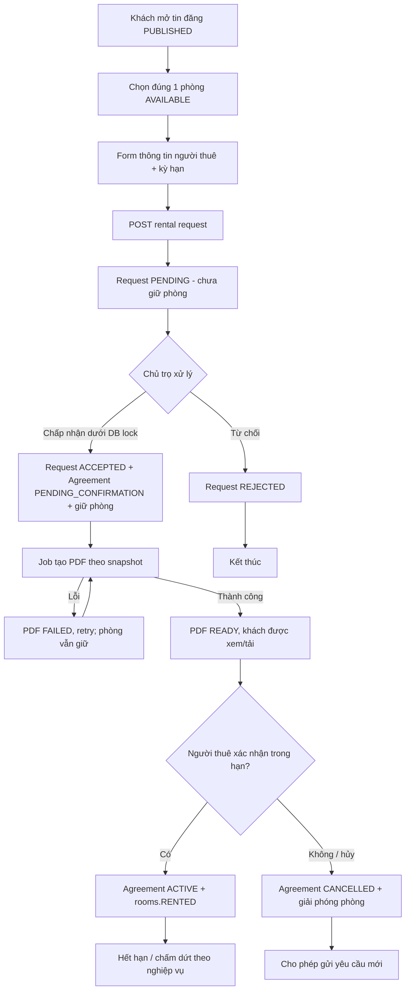

# ĐẶC TẢ TRIỂN KHAI: ĐẶT PHÒNG TRỌ + DB LOCK + HỢP ĐỒNG PDF (BACKEND & FRONTEND)

> **Lệnh cho Codex:** Đọc toàn bộ file này, kiểm tra source code hiện có trong cả repository BE và FE, sau đó **triển khai code thực tế end-to-end**, không chỉ viết hướng dẫn hoặc mock API. Tái sử dụng cấu trúc module, conventions, Jwt/Spring Security, ApiResponse/PageResponse, exception handler, Cloudinary, notification và UI framework hiện hữu. Không tự bịa cấu trúc FE; hãy khảo sát repository trước khi sửa. Hoàn thành theo các tiêu chí nghiệm thu cuối file.

## 0. Phạm vi, các ràng buộc cứng

- Hệ thống: quản lý/cho thuê trọ, Backend Java 21 + Spring Boot + JPA/Hibernate + MySQL 8 InnoDB + Flyway; Frontend sử dụng framework/thư viện **đang có trong source**.
- **Một bản ghi `rooms` đại diện đúng 01 phòng vật lý; số lượng phòng luôn là 1.** Không thêm `quantity`, `stock`, `available_quantity`; không có đặt số lượng nhiều; một yêu cầu thuê chọn **đúng một `room_id`**.
- Một `property` có thể có nhiều `rooms`; `listings.property_id` liên kết tới property, **không liên kết trực tiếp một room**. Vì thế màn hình chi tiết tin đăng phải chọn phòng cụ thể thuộc property đó.
- **Không cho hai hợp đồng đang giữ chỗ/hiệu lực cùng chiếm một phòng**, kể cả các request chạy đồng thời trên nhiều instance BE.
- Tách **yêu cầu đặt phòng (rental_request)**, **chấp nhận và giữ phòng**, **tạo PDF hợp đồng**, **khách thuê xác nhận**, **hợp đồng có hiệu lực**.
- Bản MVP này là **đăng ký thuê dài hạn một lần cho một phòng, không hỗ trợ đặt theo khoảng thời gian kiểu khách sạn và không hỗ trợ đặt trước nhiều hợp đồng cho các khoảng tương lai khác nhau**. Phòng đã bị giữ/đang thuê không nhận booking mới, bất kể ngày dự kiến vào ở.
- **Không thanh toán tiền thuê, tiền cọc hoặc VNPay** trong luồng này; tuyệt đối không dùng bảng `payments` hiện có (bảng đó phục vụ gói tin/boost).
- Khi chủ trọ nhấn **Chấp nhận**, phải tạo bản ghi hợp đồng và đưa vào hàng đợi/tác vụ tạo file PDF; khách xem được PDF ngay khi tạo xong. PDF là tài liệu cố định sau khi phát hành; xác nhận qua nút UI là **ghi nhận đồng ý điện tử trong ứng dụng**, **không được quảng bá là chữ ký số được chứng thực**.
- Phải có migration mới, không sửa migration đã chạy trên DB. `spring.jpa.hibernate.ddl-auto=validate` vẫn hoạt động sau migration.

## 1. Schema V14 hiện tại — PHẢI đọc và giữ tương thích

Dựa trên file schema V14 do người dùng cung cấp:

| Bảng | Cột / liên hệ quan trọng hiện có |
|---|---|
| `properties` | `id`, `landlord_id`, `rental_mode` (`WHOLE`/`BY_ROOM`), `property_type_id` |
| `listings` | `id`, `property_id`, `status` (`PENDING`/`PUBLISHED`/`REJECTED`/`HIDDEN`/`EXPIRED`), `expires_at` |
| `rooms` | `id`, `property_id`, `room_number`, `rental_status` (`AVAILABLE`/`RENTED`/`MAINTENANCE`), `price`, `default_deposit`, `electricity_price`, `water_price`, `service_fee`, `max_occupants` |
| `rental_requests` | `id`, `listing_id`, `tenant_id`, `landlord_id`, `message`, `proposed_move_in_date`, `status` (`PENDING`/`ACCEPTED`/`REJECTED`/`EXPIRED`/`CANCELLED`), `expires_at`, `pending_key`, `responded_at` |
| `rental_agreements` | `id`, `agreement_code`, `rental_request_id`, **`room_id`**, `tenant_id`, `landlord_id`, `price`, `deposit`, `electricity_price`, `water_price`, `service_fee`, `payment_cycle_months`, `start_date`, `end_date`, `terms_text`, `pdf_url`, `pdf_public_id`, `status` (`DRAFT`/`PENDING_CONFIRMATION`/`ACTIVE`/`EXPIRED`/`TERMINATED`/`CANCELLED`), `created_by_role`, `landlord_confirmed_at`, `tenant_confirmed_at` |
| `users` | `id`, `full_name`, `phone`, `email`, `citizen_id`, `status` |
| `notifications` | `user_id`, `type` gồm `RENTAL_REQUEST`/`RENTAL_AGREEMENT`, `reference_type`, `reference_id` |

**Vấn đề thiếu trong schema:** `rental_requests` chưa có `room_id`, chưa đủ snapshot thông tin người thuê; `rental_agreements` chưa có cơ chế giữ phòng, theo dõi job PDF và thời hạn xác nhận. Schema không có unique constraint ngăn các hợp đồng cùng phòng đang ở trạng thái giữ chỗ/hiệu lực. Phải bổ sung.

**Property WHOLE:** Một property cho thuê nguyên căn chỉ được có **một đơn vị có thể đặt** theo mô hình room hiện tại: đại diện bởi một `room` tổng (được tạo/duy trì theo logic property hiện hữu). Không để UI chọn và đặt từng room con thuộc property `WHOLE`. Nếu repo chưa có quy ước `room` đại diện cho WHOLE thì **không tự động tạo dữ liệu**, yêu cầu mapping hợp lệ hoặc trả lỗi rõ ràng; không tạo booking chung chung mà thiếu `room_id`. Với `BY_ROOM`, mỗi phòng được đặt độc lập.

## 2. Luồng nghiệp vụ tổng thể



### 2.1. Quy tắc trạng thái

| Thời điểm | `rental_requests.status` | `rental_agreements.status` | Trạng thái chiếm phòng hiệu dụng | `rooms.rental_status` |
|---|---|---|---|---|
| Chưa có yêu cầu | — | — | FREE | `AVAILABLE` |
| Một/nhiều khách gửi yêu cầu | `PENDING` | — | FREE | `AVAILABLE` |
| Chủ trọ chọn 1 yêu cầu | `ACCEPTED` | `PENDING_CONFIRMATION` | **HELD** | `AVAILABLE` |
| PDF đang tạo / lỗi chờ retry | `ACCEPTED` | `PENDING_CONFIRMATION` | **HELD** | `AVAILABLE` |
| Khách xác nhận PDF | `ACCEPTED` | `ACTIVE` | **OCCUPIED** | `RENTED` |
| Khách từ chối / hết hạn xác nhận | `ACCEPTED` (lưu lịch sử) | `CANCELLED` | FREE | `AVAILABLE` nếu không bảo trì |
| Thuê hết hạn và hoàn tất bàn giao / kết thúc sớm | `ACCEPTED` | `EXPIRED`/`TERMINATED` | FREE | `AVAILABLE` sau xử lý trả phòng |

**Lưu ý bắt buộc:** `rooms.rental_status = AVAILABLE` **không có nghĩa phòng đang nhận booking**. Phải tính thêm agreement trạng thái `PENDING_CONFIRMATION` hoặc `ACTIVE`. Frontend hiển thị `AVAILABLE`, `HELD`, `RENTED`, `MAINTENANCE` từ một trường **`bookingAvailability` được backend tính**, không tự suy từ room status. `HELD` chỉ là trạng thái suy diễn, **không cần sửa enum `rooms.rental_status`**.

- `rental_requests.PENDING`: có thể nhiều người thuê cùng xin một phòng; cùng **một tenant** chỉ có tối đa một PENDING cho cùng room.
- `rental_requests.ACCEPTED`: chủ trọ đã chọn, **chưa chứng minh khách đã ký/xác nhận**.
- `rental_agreements.PENDING_CONFIRMATION`: đã giữ phòng, đã ghi nhận chủ trọ đồng ý, PDF phải tạo; chỉ khách đúng hợp đồng có quyền xác nhận.
- `rental_agreements.ACTIVE`: khách đã xác nhận, `rooms.RENTED`. Không tự kích hoạt khi mới tạo PDF.
- Khi một request được chấp nhận, **tự động REJECTED các PENDING request khác của cùng room** (nếu sau đó giữ chỗ hết hạn, người khác muốn thuê phải gửi request mới).
- Không reset phòng `MAINTENANCE` thành `AVAILABLE`; không tự cập nhật `RENTED -> AVAILABLE` chỉ dựa vào `end_date` khi chưa có nghiệp vụ trả phòng/đóng hợp đồng an toàn.
- `listing.status` vẫn theo lifecycle tin đăng hiện có, không ép chuyển `HIDDEN/EXPIRED` chỉ vì một phòng trong property được thuê; hiển thị từng phòng đang nhận booking hay không.

## 3. Form đặt phòng (TENANT)

Tại `listing detail` hiển thị từng phòng hợp lệ của property cùng ảnh, tên/mã phòng, giá thuê, cọc, điện/nước/phí dịch vụ, diện tích, số người tối đa và `bookingAvailability`. Khi tenant nhấn **Đặt phòng** của một room, mở modal hoặc trang nhập:

| Field UI / API | Bắt buộc | Quy tắc |
|---|---|---|
| `listingId` + `roomId` | Có | `room.property_id == listing.property_id`; client không được tự chọn landlord |
| `tenantFullName` | Có | 2–100 ký tự; gợi ý từ user nhưng cho phép sửa snapshot |
| `tenantPhone` | Có | SĐT hợp lệ; gợi ý từ user |
| `tenantEmail` | Có | Email hợp lệ; gợi ý từ user |
| `tenantCitizenId` | Có | 9 hoặc 12 chữ số theo quy tắc sản phẩm; không tiết lộ trên response danh sách |
| `tenantPermanentAddress` | Có | 5–500 ký tự |
| `proposedMoveInDate` | Có | Không trước ngày hiện tại theo timezone Asia/Ho_Chi_Minh |
| `durationMonths` | Có | 1–36, số nguyên; end_date tính phía server |
| `occupantCount` | Có | 1..`rooms.max_occupants` |
| `message` | Không | tối đa 2000 ký tự, không đưa nguyên văn vào HTML/PDF nếu chưa escape |
| `acceptedPrivacyNotice` | Có | checkbox UI xác nhận đã đọc thông báo xử lý dữ liệu; server kiểm tra true, không xem như chữ ký hợp đồng |

Thông tin giá/cọc/điện/nước/phí dịch vụ hiển thị **read-only**, lấy từ API; không tin giá tiền do FE gửi. Ngày kết thúc theo quy ước `startDate.plusMonths(durationMonths).minusDays(1)`; tránh bug cuối tháng và hiển thị rõ cả hai mốc ngày trước khi gửi. Nếu thuê trong ngày không phù hợp yêu cầu hiện tại, server kiểm tra và trả validation error.

UX: kiểm tra token và role, validate form (cả FE + BE), loading và disable submit khi gọi API, thông báo thành công, điều hướng trang `Yêu cầu thuê của tôi`. Không cho tenant đặt phòng thuộc property của mình. Double click/timeout/retry không được tạo duplicate request.

## 4. Migration Flyway (không chỉnh baseline V14)

1. Xác định migration version lớn nhất thực tế ở `src/main/resources/db/migration` và bảng `flyway_schema_history`; tạo **file version tiếp theo chưa dùng**, ví dụ `V15__rental_booking_contract_workflow.sql` **chỉ khi** version 15 chưa tồn tại. Tuyệt đối không giả định repo đang dùng V14 dưới tên `V14__...`.
2. Trước khi thêm unique, kiểm tra data hiện có; **không xóa/sửa dữ liệu lịch sử tùy tiện**. Nếu dữ liệu xung đột thì migration báo lỗi và đưa ra script báo cáo để người dùng xử lý.
3. Bổ sung (đặt type/collation theo schema thực):

**`rental_requests`:**

- `room_id VARCHAR(36)` FK → `rooms(id)`; với DB đã có request cũ, cho `NULL` để giữ lịch sử; **mọi booking mới bắt buộc non-null ở service**.
- `tenant_full_name VARCHAR(100)`, `tenant_phone VARCHAR(20)`, `tenant_email VARCHAR(255)`, `tenant_citizen_id VARCHAR(20)`, `tenant_permanent_address VARCHAR(500)`, `occupant_count INT`, `duration_months INT` (nullable phục vụ dữ liệu legacy, bắt buộc khi tạo mới).
- Unique **generated-column** cho một request `PENDING`/tenant/room: `open_request_key` tạo từ `tenant_id`, `room_id` nếu `status='PENDING' AND room_id IS NOT NULL`, ngược lại `NULL`; `UNIQUE(open_request_key)`; dùng VARCHAR đủ dài, tránh unique trên nullable multi columns trực tiếp vì MySQL cho nhiều NULL. Có thể dùng cột generated `open_tenant_id` và unique `(room_id, open_tenant_id)` để dễ index; chọn một và thêm unit test.
- `INDEX(room_id,status,created_at)` phục vụ tìm request cùng room.
- `pending_key` hiện có: kiểm tra mục đích và cách build hiện tại, không ghi đè logic khác; unique guard mới là nguồn bảo đảm duplicate. Nếu logic cũ vẫn dùng `pending_key`, bảo đảm key có `room_id` thay vì chỉ listing, để không chặn các room khác nhau.

**`rental_agreements`:**

- `confirmation_expires_at DATETIME NULL`; `pdf_status ENUM('PENDING','PROCESSING','READY','FAILED') NOT NULL DEFAULT 'PENDING'`; `pdf_error VARCHAR(500) NULL`; `pdf_generated_at DATETIME NULL`; `pdf_sha256 CHAR(64) NULL`; `contract_snapshot JSON NULL` (snapshot bất biến của tên hai bên, phòng, property, địa chỉ, tiền, kỳ hạn, điều khoản và thời điểm landlord chấp thuận).
- `UNIQUE(rental_request_id)` (MySQL cho phép NULL đối với hợp đồng legacy không liên kết request) sau khi kiểm tra trùng dữ liệu cũ.
- **Chốt chặn ở DB:** generated `occupied_room_id VARCHAR(36) GENERATED ALWAYS AS (CASE WHEN status IN ('DRAFT','PENDING_CONFIRMATION','ACTIVE') THEN room_id ELSE NULL END) STORED` và `UNIQUE(occupied_room_id)`. Vì hiện tại DRAFT có thể được tạo ở module khác, bao gồm DRAFT để tránh hợp đồng mở khác cùng phòng. Nếu có DRAFT legacy và gây xung đột, dừng và yêu cầu rà soát; không tự loại DRAFT để né lỗi.
- `INDEX(status,confirmation_expires_at)`; có thể thêm `INDEX(room_id,status)` nếu cần.
- Chặn giá, thời hạn, số người không hợp lệ ở service; cân nhắc DB CHECK phù hợp MySQL 8.0.16+.

**Dữ liệu cá nhân:** Snapshot CCCD/địa chỉ phải hạn chế truy cập; kiểm tra cơ chế mã hóa ở rest hiện có và tái sử dụng, không tự log request body/CCCD. Nếu chưa có encryption framework phù hợp, document rõ hạn chế trước production, tối thiểu mask response và phân quyền. Không gửi document qua URL Cloudinary public.

**Quan trọng:** Không tạo bảng `booking_orders` riêng chỉ để đồng nghĩa với `rental_requests`; tái sử dụng bảng hiện có. Không sửa bảng `payments` của service/boost.

## 5. DB lock & giao dịch chống double-booking (BE bắt buộc)

**Cơ chế chính: `PESSIMISTIC_WRITE` trên ROW `rooms.id`**, ánh xạ InnoDB `SELECT ... FOR UPDATE`, cộng **unique generated index** ở DB làm lớp bảo vệ cuối cùng.

```java
public interface RoomRepository extends JpaRepository<Room, String> {
    @Lock(LockModeType.PESSIMISTIC_WRITE)
    @QueryHints(@QueryHint(name = "jakarta.persistence.lock.timeout", value = "3000"))
    @Query("select r from Room r where r.id = :roomId")
    Optional<Room> findByIdForUpdate(@Param("roomId") String roomId);
}
```

> Nếu UUID entity mapping không phải `String`, dùng type đang có. Timeout ở trên là **gợi ý**, cần xác minh provider/MySQL có áp dụng đúng; cấu hình `innodb_lock_wait_timeout`/exception handler thực tế, map lock timeout/deadlock sang `409 ROOM_BUSY`, không dựa duy nhất hint. Mọi write quan trọng phải có `@Transactional`.

### Quy tắc lock order không được phá vỡ

- **Mọi endpoint thay đổi availability/hợp đồng của room đều lock `rooms(id)` trước**, rồi mới lock request/agreement theo id nếu cần. Kể cả approve, reject/cancel khi ảnh hưởng giữ phòng, tenant confirm, timeout, terminate/checkout, admin cập nhật rental_status, tạo agreement thủ công.
- Đối với endpoint chỉ biết `requestId`/`agreementId`, query **read-only để lấy `roomId` trước** (không lock row), sau đó khóa `Room`, rồi load lại request/agreement dưới khóa để kiểm tra lại trạng thái và ownership. Tuyệt đối không `findByIdForUpdate(request)` trước rồi mới `Room`: dễ deadlock nếu hai flow khóa ngược thứ tự.
- Không gọi Cloudinary, render PDF, email, HTTP hoặc WebSocket **bên trong giao dịch đang giữ row lock**.
- Khi có nhiều room (về sau), khóa theo `roomId` tăng dần; MVP này luôn một room.
- Data integrity nhờ **giao dịch + DB unique guard**; Redis lock **không thay thế** InnoDB lock.

### 5.1. Gửi yêu cầu thuê: `POST /api/rental-requests`

```text
1. Authorize TENANT, user ACTIVE; verify idempotency key/request replay.
2. Đọc listing, property, room; đảm bảo listing PUBLISHED và chưa hết hạn,
   room thuộc property, room cho phép đặt và user không phải landlord.
3. @Transactional: lock Room(id) FOR UPDATE.
4. Revalidate tất cả trạng thái/ownership/availability dưới lock:
   room.rental_status == AVAILABLE, không tồn tại occupied agreement
   status DRAFT/PENDING_CONFIRMATION/ACTIVE cho room.
5. Kiểm tra chưa có PENDING request của tenant này cho room.
6. Lưu rental_requests(status=PENDING, room_id, thông tin snapshot,
   expires_at = now + 7 ngày, landlord_id lấy từ property,
   proposed_move_in_date, durationMonths, occupantCount...).
7. Commit. Sau commit gửi notification cho landlord.
8. HTTP 201 với requestId/status. Không chuyển rooms.RENTED, không giữ phòng.
```

Định nghĩa idempotency: `Idempotency-Key` (UUID do FE tạo, tái sử dụng khi retry cùng thao tác) lưu bền vững hoặc dùng unique pending guard + trả lại request PENDING của chính tenant theo `(tenantId,roomId)`. **Không** trả success cho request mới với payload khác như thể đã tạo; phản hồi rõ duplicate/conflict hoặc idempotent original. Kiểm tra hợp đồng khác của cùng tenant nếu business không cho thuê đồng thời (tuỳ yêu cầu repo), không tự áp rule vượt phạm vi.

### 5.2. Chủ trọ chấp nhận: `POST /api/landlord/rental-requests/{id}/accept`

Đây là điểm **quan trọng nhất** cần lock và test concurrency.

```text
1. Lấy roomId từ request (non-locking lookup).
2. @Transactional: lock Room(roomId) FOR UPDATE.
3. Re-read rental request, check PENDING, chưa expires, landlord == principal,
   listing/property/room vẫn hợp lệ, room AVAILABLE,
   chưa có agreement occupied cho room.
4. Ghi request.status=ACCEPTED, responded_at=now.
5. Tạo đúng 01 rental_agreements:
   - rental_request_id, room_id, tenant_id, landlord_id
   - agreement_code unique, status=PENDING_CONFIRMATION
   - created_by_role=LANDLORD
   - landlord_confirmed_at=now, tenant_confirmed_at=null
   - start_date=proposedMoveInDate; end_date=plusMonths(duration).minusDays(1)
   - price/deposit/electricity/water/service_fee lấy từ room tại thời điểm accept
   - payment_cycle_months=1 (theo MVP; hoặc config rõ ràng)
   - terms_text từ template đã cấu hình, KHÔNG nhận điều khoản HTML tuỳ ý từ FE
   - contract_snapshot đầy đủ và bất biến
   - confirmation_expires_at=now+48h
   - pdf_status=PENDING
6. Chuyển các PENDING request *khác cùng room* thành REJECTED,
   responded_at=now, message thông báo phù hợp.
7. Lưu outbox/event tạo PDF sau commit (ưu tiên outbox DB;
   nếu chưa có thì scheduled job quét pdf_status=PENDING/FAILED có retry,
   chạy được sau restart). KHÔNG tạo PDF khi còn lock.
8. Commit. Trả agreementId, status, pdfStatus=PENDING.
```

- Hai chủ trọ request chấp nhận đồng thời, chỉ giao dịch có row lock trước mới thành công; giao dịch còn lại sau khi đợi sẽ nhận `409 ROOM_UNAVAILABLE/REQUEST_NOT_PENDING`.
- Nếu tạo agreement trùng do code path khác, generated **unique occupied_room_id** gây lỗi `DuplicateKey`/constraint violation → rollback tất cả thay đổi request; handler trả 409. Không swallow exception và commit trạng thái trung gian.
- Nhấn Accept lại cho cùng id chỉ được trả hợp đồng đã tạo khi xác định là retry idempotent; không tạo PDF/agreement thứ hai.

### 5.3. Người thuê xác nhận: `POST /api/rental-agreements/{id}/confirm`

```text
1. Lấy roomId của agreement, @Transactional lock Room trước.
2. Load lại agreement và kiểm tra đúng tenant, status=PENDING_CONFIRMATION,
   pdf_status=READY, pdf_sha256 không null, chưa quá confirmation_expires_at.
3. Client truyền accepted=true và expectedPdfSha256 đúng với PDF đã hiển thị,
   trường hợp mismatch trả 409 CONTRACT_CHANGED.
4. Set tenant_confirmed_at=now, status=ACTIVE, room.rental_status=RENTED.
5. Commit; audit confirmation và gửi notification sau commit.
```

- Chủ trọ đã ghi nhận xác nhận ở lúc accept; **không giả mạo chữ ký viết tay/digital signature** của hai bên trên PDF.
- Tại bước confirm, FE hiển thị checkbox “Tôi đã đọc và đồng ý với nội dung hợp đồng số ...” (không tick sẵn) và nút Xác nhận; lưu audit: tenantId, agreementId, timestamp, PDF hash, tùy chính sách IP/user-agent (không log token/PII).
- Nếu PDF chưa sẵn sàng: `409 CONTRACT_PDF_NOT_READY`. Nếu timeout: `409 CONTRACT_CONFIRMATION_EXPIRED`.
- Xác nhận lặp lại khi ACTIVE thuộc đúng tenant có thể trả kết quả hiện tại, không ghi lại xác nhận lần 2.

### 5.4. Hủy, từ chối, hết hạn

- TENANT có thể `CANCEL` **PENDING request** của mình; lock Room trước và check status.
- LANDLORD có thể `REJECT` PENDING request của property mình; lock Room và check status.
- TENANT từ chối hợp đồng đang `PENDING_CONFIRMATION` qua `POST /api/rental-agreements/{id}/decline`; lock Room, set agreement `CANCELLED`, **release hold**; request vẫn `ACCEPTED` (audit), gửi notification.
- Scheduler expire `rental_requests.PENDING` quá `expires_at` → `EXPIRED`, không làm thay đổi room.
- Scheduler expire agreement `PENDING_CONFIRMATION` quá `confirmation_expires_at` → `CANCELLED`, release hold; ghi lý do timeout ở audit/notification (hoặc thêm `cancel_reason` nếu đã có pattern). Lock Room theo cùng thứ tự. Đây **không phải** `EXPIRED` của hợp đồng thuê đã kết thúc.
- Chấm dứt/hết hạn thuê ACTIVE phải qua nghiệp vụ bàn giao/checkout riêng: lock room, close agreement `TERMINATED`/`EXPIRED`, chuyển phòng `AVAILABLE` **chỉ khi** landlord xác nhận trả phòng và không MAINTENANCE; không tự mở lại phòng ngay khi tới end_date.
- Scheduler xử lý theo page/batch có giới hạn, tránh giữ lock lớn; multiple instances dùng row-level locking cho từng room và status recheck, tránh send notification trùng.

## 6. PDF hợp đồng — yêu cầu kỹ thuật

Tạo module/service `RentalContractPdfService` (đặt theo convention repo). **Tái sử dụng Cloudinary integration hiện có**; PDF phải bảo vệ truy cập theo principal. Chọn thư viện PDF hỗ trợ Unicode và nhúng font tiếng Việt có license hợp lệ trong app (ví dụ OpenPDF/PDFBox tùy compatibility); không lấy font hệ điều hành production mặc định, không tạo chữ Việt lỗi dấu. Không cần áp dụng công cụ PDF trong ChatGPT; Codex sẽ làm tính năng PDF runtime của ứng dụng.

**Nội dung PDF bắt buộc**:

- Tiêu đề: **HỢP ĐỒNG THUÊ PHÒNG TRỌ**; mã hợp đồng và ngày lập.
- Bên A (chủ trọ): họ tên, SĐT, email từ thông tin hợp lệ đã snapshot lúc accept; địa chỉ liên hệ nếu repo có, nếu thiếu thì dùng placeholder “Chưa cung cấp”, không chế dữ liệu.
- Bên B (người thuê): họ tên, SĐT, email, CCCD, địa chỉ thường trú từ rental request snapshot.
- Tài sản: tên property, địa chỉ property (province/ward/address_line), mã phòng, loại phòng, diện tích, số người tối đa.
- Giá thuê/tháng, tiền cọc, giá điện, nước, phí dịch vụ (VND và đơn vị tính được cấu hình; không tự đoán m3/kWh nếu DB không lưu rõ đơn vị), kỳ thanh toán.
- Ngày bắt đầu/kết thúc, thời hạn thuê, trách nhiệm thanh toán, bảo quản, thông báo chấm dứt theo **template điều khoản đã duyệt**, không khẳng định pháp lý khi chưa có template.
- Mục xác nhận của chủ trọ và người thuê; thể hiện thời gian **đồng ý trong hệ thống** nếu có, **không giả chữ ký tay**. PDF phát hành tại thời điểm landlord accept có trạng thái chờ tenant xác nhận; bản PDF **không thay đổi sau xác nhận**, trạng thái xác nhận xem trong app/audit. Nếu muốn phiên bản đã ký chứa timestamp của khách, phải tạo file phiên bản riêng có audit, không ghi đè PDF đã được hash/xác nhận.

**Luồng tạo PDF đáng tin cậy**:

1. Agreement PENDING_CONFIRMATION được commit cùng `contract_snapshot`, `pdf_status=PENDING`.
2. Worker sau commit chọn agreement `pdf_status=PENDING/FAILED`, lock/claim job phù hợp để tránh upload trùng trên nhiều worker, set PROCESSING. Có `attempt_count`, `next_retry_at`/lease timeout hoặc outbox đáng tin cậy. Nếu worker chết khi PROCESSING, job được reclaim.
3. Sinh PDF từ **snapshot**, không đọc giá/CCCD trực tiếp từ entity có thể thay đổi.
4. Tính SHA-256 **trên bytes PDF thực**, upload private/authenticated Cloudinary hoặc private object storage; ghi `pdf_public_id`, `pdf_url` nếu cần theo schema, `pdf_sha256`, `pdf_generated_at`, `pdf_status=READY` sau khi thành công. Dọn orphan file nếu upload thành công nhưng DB save thất bại (reconciliation job).
5. Nếu thất bại, `FAILED`, ghi `pdf_error` rút gọn không chứa PII; retry có giới hạn/backoff; log và hiển thị trạng thái cho landlord/tenant. **Không rollback việc accept và không giải phóng hold chỉ vì lỗi PDF tạm thời.**
6. BE cung cấp `GET /api/rental-agreements/{id}/pdf` stream `application/pdf` và `Content-Disposition: inline; filename=...pdf`; `download=true` để attachment (hoặc 2 endpoint). Check requester là tenant/landlord của agreement hoặc admin được quyền; không dùng URL public không bảo vệ và không trả `pdf_public_id` ra FE.
7. Nếu PDF chưa READY: trả `409 CONTRACT_PDF_NOT_READY` + trạng thái; FE hiện spinner và nút Refresh/Tải lại; polling có giới hạn (ví dụ 5s, dừng khi READY/FAILED/unmount) hoặc dùng hệ thống notification sẵn có.

**Không tạo PDF bằng cách render từ những giá trị FE truyền lên**, không sửa template PDF của hợp đồng đã được chấp nhận khi room giá thay đổi.

## 7. API contract đề xuất (điều chỉnh prefix nếu repo hiện tại đã có convention)

Giữ `ApiResponse<T>` và `PageResponse<T>` của backend hiện có, áp dụng Spring Validation, security & exception mapping. Tất cả ID từ DB là UUID string theo code hiện tại. Các endpoint list có pagination (không query all).

| Method | Endpoint | Role | Tác dụng |
|---|---|---|---|
| GET | `/api/listings/{listingId}/bookable-rooms` | Public | Phòng thuộc property, trạng thái đặt hiệu dụng (không lộ PII) |
| POST | `/api/rental-requests` | TENANT | Tạo yêu cầu thuê 1 room |
| GET | `/api/rental-requests/my?page=0&size=10` | TENANT | Danh sách yêu cầu của tôi |
| GET | `/api/rental-requests/{id}` | TENANT/LANDLORD/ADMIN theo ownership | Chi tiết request; mask thông tin nhạy cảm |
| POST | `/api/rental-requests/{id}/cancel` | TENANT | Hủy PENDING request |
| GET | `/api/landlord/rental-requests?status=PENDING&page=0&size=10` | LANDLORD | Yêu cầu gửi tới phòng của mình |
| POST | `/api/landlord/rental-requests/{id}/accept` | LANDLORD sở hữu | Chấp nhận, giữ phòng, tạo agreement và enqueue PDF |
| POST | `/api/landlord/rental-requests/{id}/reject` | LANDLORD sở hữu | Từ chối request PENDING; body có `reason` optional |
| GET | `/api/rental-agreements/{id}` | TENANT/LANDLORD/ADMIN theo ownership | Detail hợp đồng và PDF state |
| GET | `/api/rental-agreements/my?page=0&size=10` | TENANT | Hợp đồng của tôi |
| GET | `/api/landlord/rental-agreements?page=0&size=10` | LANDLORD | Hợp đồng tại property sở hữu |
| GET | `/api/rental-agreements/{id}/pdf` | TENANT/LANDLORD/ADMIN theo ownership | Xem/download PDF private |
| POST | `/api/rental-agreements/{id}/confirm` | TENANT đúng agreement | Xác nhận nội dung PDF → ACTIVE |
| POST | `/api/rental-agreements/{id}/decline` | TENANT đúng agreement | Từ chối hợp đồng chưa xác nhận → release |
| POST | `/api/landlord/rental-agreements/{id}/checkout` | LANDLORD sở hữu (kèm policy) | Chấm dứt/hoàn tất trả phòng, mở booking khi an toàn |

### 7.1. Ví dụ request tạo booking

```http
POST /api/rental-requests
Authorization: Bearer <JWT>
Idempotency-Key: 1dd05a0d-f78e-4d3b-8171-a2da98266db1
Content-Type: application/json
```

```json
{
  "listingId": "UUID_LISTING",
  "roomId": "UUID_ROOM",
  "tenantFullName": "Nguyễn Văn A",
  "tenantPhone": "0912345678",
  "tenantEmail": "tenant@example.com",
  "tenantCitizenId": "012345678901",
  "tenantPermanentAddress": "Phường X, Hà Nội",
  "proposedMoveInDate": "2026-11-15",
  "durationMonths": 12,
  "occupantCount": 2,
  "message": "Mong được xem phòng trước khi nhận",
  "acceptedPrivacyNotice": true
}
```

Response 201 (phần data nằm trong envelope sẵn có):

```json
{
  "id": "UUID_REQUEST",
  "listingId": "UUID_LISTING",
  "roomId": "UUID_ROOM",
  "status": "PENDING",
  "createdAt": "2026-10-29T22:00:00",
  "expiresAt": "2026-11-05T22:00:00"
}
```

**Accept response:**

```json
{
  "requestId": "UUID_REQUEST",
  "agreementId": "UUID_AGREEMENT",
  "requestStatus": "ACCEPTED",
  "agreementStatus": "PENDING_CONFIRMATION",
  "pdfStatus": "PENDING",
  "confirmationExpiresAt": "2026-10-31T22:00:00"
}
```

**Confirm request:**

```json
{
  "accepted": true,
  "expectedPdfSha256": "64_HEX_CHARACTERS_OF_DOWNLOADED_PDF"
}
```

**Agreement detail** gồm `id`, `agreementCode`, `roomId`, `roomNumber`, `propertyName`, `tenantName` (role-appropriate), `landlordName`, `price`, `deposit`, `startDate`, `endDate`, `status`, `pdfStatus`, `pdfSha256` (sau READY), `confirmationExpiresAt`, `landlordConfirmedAt`, `tenantConfirmedAt`, quyền thao tác `canConfirm`, `canDecline`, `canDownloadPdf`. Không public tenantCitizenId trong list response.

### 7.2. Error contract

- 400 `VALIDATION_ERROR`: request sai, chưa nhập trường bắt buộc, occupant quá giới hạn.
- 401 `UNAUTHENTICATED`; 403 `FORBIDDEN` ownership/role.
- 404 `LISTING_NOT_FOUND`, `ROOM_NOT_FOUND`, `RENTAL_REQUEST_NOT_FOUND`, `AGREEMENT_NOT_FOUND` (có thể dùng 404 để ẩn resource của người khác tùy convention).
- 409 `ROOM_UNAVAILABLE` (đã giữ/thuê/bảo trì), `ROOM_BUSY` (row lock timeout/deadlock), `REQUEST_ALREADY_PENDING`, `REQUEST_NOT_PENDING`, `AGREEMENT_ALREADY_EXISTS`, `CONTRACT_PDF_NOT_READY`, `CONTRACT_CHANGED`, `CONTRACT_CONFIRMATION_EXPIRED`, `INVALID_AGREEMENT_STATUS`.
- 422 nếu repo đã dùng cho business rules; giữ nhất quán với exception handler.
- 500/503 `PDF_GENERATION_FAILED` chỉ trên API truy xuất file khi failed; accept không bị 500 vì job PDF async.

## 8. Backend architecture và DTO

Theo source hiện có, ưu tiên các package như:

```text
com.tamdaptit.rentalmanagement/
├─ rental/
│  ├─ controller/       RentalRequestController, LandlordRentalRequestController,
│  │                    RentalAgreementController, LandlordRentalAgreementController
│  ├─ dto/request/      RentalRequestCreateRequest, RentalRequestRejectRequest,
│  │                    RentalAgreementConfirmRequest, RentalCheckoutRequest
│  ├─ dto/response/     RentalRequestResponse, RentalAgreementResponse,
│  │                    BookableRoomResponse
│  ├─ entity/           RentalRequest, RentalAgreement (+ enums theo source)
│  ├─ repository/       RentalRequestRepository, RentalAgreementRepository
│  └─ service/          RentalRequestService, RentalAgreementService,
│                       RentalContractPdfService, RentalPdfWorker
├─ room/repository/     RoomRepository (bổ sung findByIdForUpdate)
└─ common/...           existing ApiResponse, exceptions, security, notification
```

**Chỉ là gợi ý**: nếu BE có sẵn module/service/controller cùng chức năng, mở rộng chúng, không sinh hai implementation cạnh tranh.

Yêu cầu backend:

- `@Valid` ở controller, DTO Jakarta Validation (`@NotNull`, `@NotBlank`, `@Email`, `@Size`, `@Pattern`, constraint custom cho ngày).
- Spring Security `@PreAuthorize` phù hợp RBAC hiện có và luôn **check ownership tại service**, không chỉ dựa vào role.
- JPA repository tránh N+1 khi list request/agreement; pagination, projection/fetch đúng.
- `@Transactional` các lệnh write, read-only ở query; tránh `@Transactional` self-invocation khiến transaction không áp dụng.
- Dùng clock có thể inject cho test, timezone thống nhất (Asia/Ho_Chi_Minh cho input LocalDate, database timestamp thống nhất UTC hoặc convention hiện hành).
- Giá từ DB `BigDecimal`; không dùng double; không tin trường price hoặc landlordId từ FE.
- Snapshot có thể là POJO serialize JSON với schema version; PDF bytes SHA-256 được tính deterministic cho file đã lưu.
- Thông báo người thuê/chủ trọ khi: request tạo, accept, reject, PDF READY/FAILED, tenant xác nhận, hợp đồng bị từ chối/timeout, checkout; trigger **sau commit** và dùng existing notification; không gửi trùng trên retry worker.
- Ghi audit có correlation/request ID và transitions; không log PII/JWT hoặc Cloudinary credentials.
- Thêm index và repository query cho `existsOccupiedAgreement(roomId)`; **không dùng kết quả query không lock làm bảo đảm cuối cùng**.
- Nếu cần modify API admin/landlord sửa room.rental_status, thực hiện theo cùng lock order + guard không cho set AVAILABLE khi có agreement giữ phòng/ACTIVE, không cho set MAINTENANCE nếu đang occupied trừ nghiệp vụ cho phép rõ ràng.
- Làm rõ interaction với các tính năng `rental_requests`/`rental_agreements` cũ: migrate và refactor callers sang service duy nhất, không để endpoint cũ bypass DB locks/unique guards.

## 9. Frontend — màn hình và hành vi bắt buộc

Tìm framework/router/state management/API client hiện tại rồi triển khai theo conventions của FE, **không tạo UI song song giả định React nếu source là framework khác**. Tạo types, typed API service, hooks/query caching (nếu đang dùng), routing, toast và loading states.

### 9.1. Chi tiết tin đăng — tenant

- Hiện danh sách phòng thuộc property của listing với ảnh, số phòng, giá, diện tích, max occupants, trạng thái hiệu dụng.
- Nút **Đặt phòng** chỉ enable khi `bookingAvailability=AVAILABLE`, listing PUBLISHED, user TENANT. Nếu chưa login, đưa tới login rồi trở lại listing. Chủ trọ không được đặt property của mình (BE vẫn bảo vệ).
- Bấm mở form theo Mục 3; room đã chọn cố định, hiển thị summary trước khi gửi; không có ô Quantity.
- Khi 409 `ROOM_UNAVAILABLE`, hiện thông báo “Phòng vừa được người khác giữ/thuê. Vui lòng chọn phòng khác.” và refresh trạng thái phòng.
- Không lộ email/CCCD tenant khác.

### 9.2. Trang `Yêu cầu thuê của tôi` — tenant

- Danh sách phân trang các request: ảnh/tên property, mã phòng, ngày yêu cầu, ngày dự kiến vào, trạng thái.
- `PENDING`: badge “Chờ chủ trọ xác nhận”, nút Hủy.
- `ACCEPTED`: “Chủ trọ đã chấp nhận”; hiển thị liên kết sang hợp đồng và trạng thái PDF.
- `REJECTED/EXPIRED/CANCELLED`: hiển thị reason/status phù hợp; không cho thao tác trái trạng thái.
- Có Empty, Loading, Error, Retry.

### 9.3. Dashboard LANDLORD — yêu cầu đặt phòng

- Tab `Chờ xử lý`, `Đã chấp nhận`, `Từ chối`, `Hết hạn`; filter theo property, room, status.
- Card/detail: thông tin khách thuê đúng quyền chủ trọ, thời gian dự kiến, kỳ hạn, số người, note; không hiển thị nguyên CCCD trong bảng list.
- Hai hành động Chấp nhận / Từ chối, modal xác nhận. Khi accept thành công, chuyển đến trang hợp đồng và chỉ trạng thái `Đang tạo PDF`, không tuyên bố “đã thuê thành công”.
- Sau khi một request được chấp nhận, các PENDING của cùng room tự thành REJECTED; UI refresh danh sách.
- Chống double-click bằng loading/disable, nhưng **DB là nơi quyết định**.

### 9.4. Chi tiết hợp đồng — tenant & landlord

- Hiển thị mã hợp đồng, property/phòng, tiền thuê, cọc, điện/nước/dịch vụ, thời hạn, hai bên, deadline xác nhận, trạng thái.
- `PENDING_CONFIRMATION + pdfStatus=PENDING/PROCESSING`: “Đang tạo hợp đồng PDF”, không bật Confirm.
- `pdfStatus=FAILED`: “Chưa thể tạo hợp đồng, hệ thống đang thử lại”; cho refresh và liên hệ hỗ trợ, không kết luận booking thất bại.
- `pdfStatus=READY`: preview PDF từ endpoint có auth (blob/stream, revoke objectURL khi unmount), nút Tải xuống; chỉ TENANT đúng hợp đồng nhìn thấy checkbox “Tôi đã đọc và đồng ý...” và Confirm/Decline.
- `ACTIVE`: hiển thị “Đã xác nhận thuê”, thời điểm xác nhận; không hiện Confirm nữa.
- `CANCELLED`: “Hợp đồng đã hủy/hết thời hạn xác nhận”, không cho Confirm.
- Không lấy `pdfSha256` từ giá trị do client tự tính giả. FE gửi đúng hash server cấp cho **phiên bản PDF đang hiển thị** (nếu dùng blob khác thì xác minh phiên bản đúng); BE đối chiếu.

### 9.5. Quản lý phòng landlord

- Phòng `HELD`: hiển thị “Đang giữ chỗ — chờ khách xác nhận hợp đồng”.
- Phòng `RENTED`: “Đã cho thuê”.
- Phòng `MAINTENANCE`: “Bảo trì”.
- Không cho chủ trọ chuyển status để bypass hợp đồng. Nếu đang HELD/RENTED, các thao tác khả dụng phải phản ánh API.
- Re-fetch khi điều hướng về trang; không coi cache availability là dữ liệu tuyệt đối.

### 9.6. UI/UX

- Giao diện responsive mobile/desktop, xác nhận/hủy có modal, trạng thái loading/empty/error đầy đủ, label tiếng Việt.
- API services dùng JWT interceptor/error handler đã có; không hardcode localhost nếu FE dùng env base URL.
- Không leak CCCD/địa chỉ trên localStorage/log/analytics; chỉ hiển thị trong trang chi tiết được cấp quyền và PDF.
- Cung cấp đường dẫn từ các menu hiện có (tenant/landlord); tránh component mồ côi không reachable.

## 10. Tình huống race condition — bắt buộc test

### Case A: Hai TENANT cùng gửi yêu cầu

- Tenant A và B gửi request tới cùng room `AVAILABLE` trong cùng thời điểm.
- **Kết quả:** có thể tồn tại 2 `PENDING` request (business cho phép cạnh tranh trước khi landlord chọn), room vẫn `AVAILABLE`; không có agreement.

### Case B: LANDLORD nhận 2 request, bấm accept đồng thời

```text
T1: accept request A                       T2: accept request B
BEGIN                                      BEGIN
SELECT room FOR UPDATE   <-- lock acquired SELECT room FOR UPDATE (wait)
check occupied = false
create agreement A PENDING_CONFIRMATION
reject pending request B
COMMIT (release lock)                      lock acquired
                                           reload request B: REJECTED
                                           reject 409
                                           ROLLBACK
```

**Kết quả bắt buộc:** đúng 1 agreement cho room ở `PENDING_CONFIRMATION/ACTIVE`, đúng 1 request `ACCEPTED`, A giữ phòng; B bị `REJECTED`, không có agreement B.

### Case C: Tenant submit trong lúc landlord accept

- Nếu accept thắng lock: submit mới trả 409 `ROOM_UNAVAILABLE`.
- Nếu submit thắng lock: request được tạo PENDING; khi accept chạy, phải reject request khác này; không để PENDING lơ lửng trên phòng đã giữ (ngoại trừ ghi nhận legacy cần xử lý).

### Case D: Double submit hoặc double accept

- Không tạo duplicate PENDING cho cùng tenant/room; không tạo 2 agreement từ cùng request.
- Unique DB key là lớp chặn cuối.

### Case E: Tenant xác nhận và scheduler timeout cùng lúc

- Cả hai lock cùng room. Chỉ một chuyển trạng thái từ `PENDING_CONFIRMATION`, event còn lại đọc lại state và no-op/409.
- Không có trạng thái `ACTIVE` nhưng room `AVAILABLE`, hoặc `CANCELLED` nhưng room `RENTED` do cùng agreement.

### Case F: PDF worker lỗi/restart/upload chậm

- Accept commit và giữ phòng thành công; lỗi PDF chỉ thay đổi pdfStatus và retry, không mở phòng; worker restart recover.
- Trước READY confirm trả 409; sau READY tenant mới có thể confirm.

### Case G: Manual room change bypass

- LANDLORD/ADMIN chỉnh room `AVAILABLE/MAINTENANCE/RENTED` khi đang giữ/phòng đang thuê; BE phát hiện occupied agreement và chặn thao tác phá invariant.

### Case H: WHOLE property & foreign room

- Truyền room_id thuộc property khác, hoặc chọn room con không hợp lệ cho `WHOLE`: 400/409, không tạo request/agreement.

## 11. Test suite phải có

- Unit tests: DTO validation, date/endDate, status transitions, mapping snapshot, permission/ownership, PDF template fields.
- Integration tests sử dụng **MySQL 8 InnoDB thật (ưu tiên Testcontainers)**; H2 không thay thế được cho `SELECT FOR UPDATE` / generated column uniqueness/ENUM.
- Concurrency tests `ExecutorService + CountDownLatch` chạy 2 transactions **thực sự song song**, không `@Transactional` bọc cả test, khởi tạo data trước; verify Case A..E.
- DB test unique occupied guard: cố insert 2 `PENDING_CONFIRMATION` cùng `room_id`, DB phải reject, kể cả bỏ qua service.
- 2 active agreement khác phòng được phép. Sau `CANCELLED`, room tạo agreement mới được; snapshot cũ không mất.
- API RBAC/IDOR: tenant X không đọc PDF tenant Y; landlord khác không accept; anonymous không nhận dữ liệu CCCD; không cho client gửi landlordId/price giả.
- PDF: UTF-8 tiếng Việt có dấu, content-type, auth, hash stable, file download valid, hồi phục khi Cloudinary fail.
- Scheduler deadline và exact-boundary tests bằng injected Clock.
- FE tests: form validation, role/availability, 409 refresh, PDF preview/confirm state, duplicate click, 401 login flow.

## 12. Quy trình Codex cần thực hiện

1. **Khảo sát repository BE và FE**: đọc `README`, migrations hiện có, entities `Room`, `Property`, `Listing`, `RentalRequest`, `RentalAgreement`, security/RBAC, `ApiResponse`, notification, Cloudinary, UI router/client. Báo cáo ngắn các path phát hiện và mọi xung đột với đặc tả.
2. **Schema migration**: thêm cột/constraint/index/generated columns, entity mapping tương thích; kiểm tra data legacy, giữ Flyway validate.
3. **Backend domain**: DTO, JPA repositories, DB locks, transactional services, state checks, exception handling, role ownership, notifications.
4. **PDF**: contract snapshot, template tiếng Việt, authenticated streaming, job/retry/recovery.
5. **Frontend**: listing room selector, form booking, tenant requests, landlord requests, agreement details/PDF preview/confirmation, nav integration.
6. **Tests**: unit, integration concurrency MySQL, security, FE tests; chạy lint/typecheck/build phù hợp repo.
7. **Tài liệu**: README mô tả flow, request/response mẫu, setup PDF/Cloudinary, migration và cách test race condition; liệt kê các file chỉnh sửa.
8. **Báo cáo cuối**: những phần đã code, đường dẫn file, migration version, kết quả build/test; nếu repo FE hoặc config Cloudinary không có, không giả vờ đã chạy thành công — ghi rõ phần blocked.

## 13. Definition of Done (tiêu chí nghiệm thu)

- [ ] Người dùng chọn **1 room thực** từ listing/property; điền đủ thông tin; đặt thành công `PENDING`.
- [ ] Không có `quantity` hoặc logic đếm hàng tồn kho.
- [ ] Backend dùng `@Transactional`, `PESSIMISTIC_WRITE`, lock order Room-first ở mọi đường làm đổi availability.
- [ ] MySQL có unique guard bảo vệ **mỗi room tối đa 1 agreement `DRAFT/PENDING_CONFIRMATION/ACTIVE`**.
- [ ] Hai request PENDING cùng room có thể cùng tồn tại từ hai tenant; chỉ 1 accept thắng.
- [ ] Landlord accept tạo **đúng 1** agreement `PENDING_CONFIRMATION` và snapshot, không chiếm phòng vĩnh viễn bằng transaction lock.
- [ ] PDF hợp đồng tiếng Việt được tạo **sau commit**, có retry/recovery, không bị public, xem/tải được khi READY.
- [ ] Chỉ tenant của hợp đồng xác nhận được; xác nhận sau khi PDF READY → ACTIVE và room RENTED cùng transaction.
- [ ] Nếu decline/timeout, hợp đồng CANCELLED, room được release; không có double-booking.
- [ ] Scheduler, manual room update, endpoints cũ không phá invariant.
- [ ] FE đầy đủ listing booking, request list, landlord approval, PDF preview/confirm, loading/errors, responsive.
- [ ] Test MySQL concurrent double-accept, confirm-vs-timeout, PDF fail/retry và RBAC đều pass.
- [ ] Flyway chạy được trên schema hợp lệ và Hibernate `ddl-auto=validate` khởi động thành công.

---

## PROMPT NGẮN ĐỂ ĐƯA CODEX CHẠY VỚI FILE NÀY

> Hãy đọc file `RENTAL_BOOKING_BE_FE_CODEX_SPEC.md` trong workspace. Triển khai toàn bộ luồng đặt phòng 1 room duy nhất cho hệ thống cho thuê trọ theo đúng schema V1 và codebase thực tế. Phải có migration Flyway tiếp theo, PESSIMISTIC_WRITE `rooms` + generated unique DB guard, transactional race-safe approval, hợp đồng PDF tiếng Việt tạo sau commit có retry, API phân quyền và FE đầy đủ. Không chỉ trả pseudo-code. Trước khi sửa, inspect cả BE/FE; sau khi sửa chạy build/tests và báo cáo chính xác kết quả. Ưu tiên reuse code hiện tại, tuyệt đối không sửa migration đã chạy hoặc dùng `payments` gói tin cho booking.
